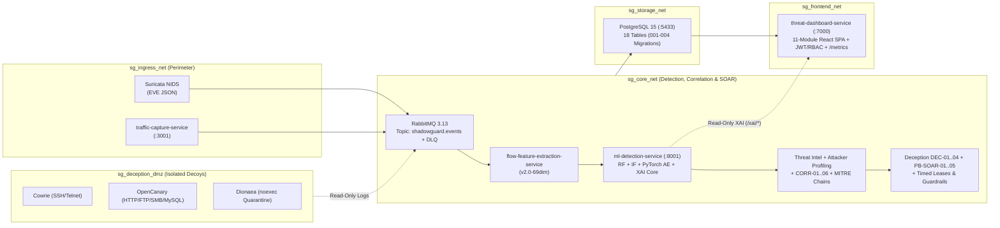

# 🛡️ Shadow Guard 2.0
### An Intelligent Cyber Defence, Cyber Deception, Tri-Model Anomaly Detection, Explainable AI (XAI) & Automated Incident Response Platform

> **B.Tech CSE Major Project (Chandigarh University)** — Event-driven, 22-container cyber defense platform unifying **69-dimensional network flow ML** (**Random Forest + Isolation Forest + PyTorch Deep Reconstruction Autoencoder**), **Explainable AI (`shap.TreeExplainer` + Perturbation Attribution + MSE Decomposition + Unified Tri-Model Explainer)**, **Suricata NIDS**, **Multi-Type Honeypots (`Cowrie`, `OpenCanary`, `Dionaea`)**, **Threat Intelligence**, **Sliding-Window Correlation (`CORR-01..06`)**, **MITRE ATT&CK Kill-Chain Reconstruction**, **Safety-Gated SOAR (`PB-SOAR-01..05`)**, and a **12-Module RBAC-Protected SOC Command Center** (including the interactive **Demo Traffic Simulator**).

> [!IMPORTANT]
> **Research & Benchmark Classification (`SYNTHETIC BENCHMARK ONLY`):** All machine-learning training/test flows (`1,524` flows) and system-level evaluation streams (`500` events across Cohorts A–E) are generated from controlled synthetic parametric benchmarks. Real-world PCAP generalization and live enterprise SOC analyst efficacy have **not** been established. See [Research Disclaimer & Limitations](#15-known-limitations--research-disclosure).

---

## ⚡ Quick Start (Local Host Verification & Native Execution)

```bash
# 1. Verify all 16 automated test & benchmark suites (517 assertions)
node scripts/run_all_verifications.js

# 2. Run Python XAI & ML unit test suites
python ml-detection-service/tests/test_xai_explainer.py
python ml-detection-service/tests/test_unified_xai_engine.py
python ml-detection-service/tests/test_xai_api.py

# 3. Start the Python ML & XAI Detection Service (Port 8001)
python ml-detection-service/main.py

# 4. Start the SOC Command Center Dashboard & API Gateway (Port 7000)
cd threat-dashboard-service && npm install && PORT=7000 node server.js
```

---

## 📑 Table of Contents

1. [Overview, Problem Statement & Motivation](#1-overview-problem-statement--motivation)
2. [Key Features & Capabilities](#2-key-features--capabilities)
3. [Complete System Architecture & Network Segmentation](#3-complete-system-architecture--network-segmentation)
4. [Technology Stack](#4-technology-stack)
5. [Three-Model Detection Architecture & Tri-Model Fusion](#5-three-model-detection-architecture--tri-model-fusion)
6. [Explainable Artificial Intelligence (XAI) Subsystem](#6-explainable-artificial-intelligence-xai-subsystem)
7. [Suricata NIDS, Cyber Deception & Honeypots](#7-suricata-nids-cyber-deception--honeypots)
8. [Threat Intelligence, Attacker Profiling, Correlation & SOAR](#8-threat-intelligence-attacker-profiling-correlation--soar)
9. [11-Module SOC Command Center & RBAC Security](#9-11-module-soc-command-center--rbac-security)
10. [Database Structure (`PostgreSQL 15`)](#10-database-structure-postgresql-15)
11. [API Documentation](#11-api-documentation)
12. [Repository Directory Structure](#12-repository-directory-structure)
13. [Installation, Environment Variables & Local Execution](#13-installation-environment-variables--local-execution)
14. [Testing, Verification Suites & Benchmark Results](#14-testing-verification-suites--benchmark-results)
15. [Known Limitations & Research Disclosure](#15-known-limitations--research-disclosure)
16. [Documentation Index & Academic Project Information](#16-documentation-index--academic-project-information)

---

## 1. Overview, Problem Statement & Motivation

Enterprise Security Operations Centers (SOCs) face multi-stage cyber campaigns combining volumetric denial-of-service floods, low-and-slow Command-and-Control (C2) beaconing, DNS/HTTP exfiltration, and post-authentication lateral movement. Standalone single-modality controls fail in complementary ways:
- **Signature-based NIDS** cannot detect novel or encrypted volumetric anomalies.
- **Standalone unsupervised flow anomaly detectors** suffer from `2%–5%` false-positive rates on legitimate enterprise traffic bursts (the base-rate fallacy), making uncorroborated automatic IP blocking operationally dangerous.
- **Black-box ensemble alerts** lack transparent feature-level reasoning, eroding SOC analyst trust.
- **Legacy Shadow Guard 1.0** suffered from a 7-column offline training vs. 69-feature runtime schema mismatch and a `max(probabilities)` confidence bug that misread high benign confidence as attack confidence.

**Shadow Guard 2.0** resolves these gaps by separating **Detection**, **Explanation**, **Correlation**, and **Safety-Gated SOAR Response** across an event-driven microservices architecture.

---

## 2. Key Features & Capabilities

- **Canonical `v2.0-69dim` Flow Pipeline**: Shared Node.js (`flow-feature-extraction-service`) and Python (`shared/ml/feature_schema.py`) extractor with bit-exact parity (`max_abs_diff = 0.0`).
- **Tri-Model Detection Engine**: Supervised **Random Forest** (`150` trees) + unsupervised **Isolation Forest** (`150` iTrees) + authoritative **PyTorch Deep Reconstruction Autoencoder** (`69 -> 32 -> 16 -> 8 -> 16 -> 32 -> 69`, frozen $P_{97} = 0.503670$) under three selectable policies (`weighted_consensus`, `unsupervised_ensemble`, `majority_vote`).
- **Read-Only Explainable AI (XAI)**: Official `shap.TreeExplainer` (`shap==0.54.1`) for Random Forest, reference-population perturbation for Isolation Forest, per-feature MSE decomposition for the Autoencoder, `ThreeScalarMeasurementGrouper`, and `UnifiedTriModelExplainer` with zero impact on detection decisions (`0/384` mismatches).
- **Multi-Sensor Telemetry**: Suricata NIDS EVE JSON (`alert`, `dns`, `http`, `tls`, `flow`) + **Cowrie** (SSH/Telnet, zero-password retention), **OpenCanary** (HTTP/FTP/SMB/MySQL), and **Dionaea** (`noexec` malware capture + SHA-256) inside an isolated deception DMZ.
- **Intelligence, Correlation & Kill Chains**: Multi-provider Threat Intel caching, 5-factor explainable attacker risk scoring (`0–100`), sliding-window correlation (`CORR-01..06`, 2s burst deduplication), and MITRE ATT&CK kill-chain reconstruction (`OBSERVED`, `INFERRED`, `SUSPECTED`).
- **Safety-Gated SOAR**: Adaptive deception (`DEC-01..04`), multi-condition playbooks (`PB-SOAR-01..05`), timed IP block leases, critical allowlists, human approval gates, and mandatory **`AE_ONLY` / `IF_ONLY` / `degraded` non-auto-block guardrails**.
- **11-Module SOC Command Center**: React 18 SPA with HMAC-SHA256 JWT authentication, RBAC (`VIEWER`, `SOC_ANALYST`, `ADMIN`), role-based IP sanitization, Prometheus `/metrics`, and immutable security audit logs.

---

## 3. Complete System Architecture & Network Segmentation

Shadow Guard 2.0 defines **22 Docker services** across **5 isolated bridge networks** (`sg_ingress_net`, `sg_core_net`, `sg_deception_dmz`, `sg_storage_net`, `sg_frontend_net`):



---

## 4. Technology Stack

| Layer | Technologies |
| :--- | :--- |
| **Machine Learning & XAI** | Python `3.14.7`, PyTorch (`2.15.0+cpu`), scikit-learn (`1.9.1`), `shap` (`0.54.1`), NumPy, SciPy, FastAPI, Uvicorn |
| **Backend Microservices** | Node.js, Express, `amqplib` (RabbitMQ topic client), `pg` (PostgreSQL pool) |
| **Frontend SOC UI** | React 18 (UMD + Babel standalone), WebSocket (`ws`), custom dark-theme CSS |
| **Messaging & Storage** | RabbitMQ 3.13 (AMQP topic exchange + DLQs), PostgreSQL 15 (`pgcrypto`, JSONB, GIN/B-Tree indexes) |
| **NIDS & Honeypots** | Suricata (`jasonish/suricata:latest`), Cowrie, OpenCanary, Dionaea |
| **Security & Observability** | HMAC-SHA256 JWT, RBAC (`VIEWER`, `SOC_ANALYST`, `ADMIN`), rate limiting, Prometheus `/metrics` |

---

## 5. Three-Model Detection Architecture & Tri-Model Fusion

| Model | Artifact | Paradigm & Output | Threshold & Role |
| :--- | :--- | :--- | :--- |
| **Random Forest** | `models/random_forest_69_v2.pkl` | Supervised (`150` trees + `StandardScaler`), `attack_probability` $P(\text{attack}\mid \mathbf{x}) \in [0, 1]$ | `0.50` (fixes legacy `max(proba)` bug) |
| **Isolation Forest** | `models/isolation_forest_69_v2.pkl` | Unsupervised (`150` iTrees + `StandardScaler`), `raw_decision_score` & monotonic `anomaly_score` (**not** a probability) | `-0.024499` (trained on `840` normal flows) |
| **PyTorch Autoencoder** | `models/autoencoder_model.pt` + `autoencoder_preprocessor.pkl` | Unsupervised (`69->32->16->8->16->32->69`, `signed_log1p` + `RobustScaler(25,75)` + `clip[-10,10]`), MSE (**not** a probability) | Frozen **$P_{97} = 0.503670$** (`3.33%` val FPR); $P_{95}=0.409105$ (warning), $P_{99}=0.645935$ (critical) |

### Tri-Model Fusion Policies (`shared/ml/tri_model_fusion.py`)
1. **`weighted_consensus` (Frozen Production Default)**: Normalizes healthy model weights (`RF=0.45`, `IF=0.25`, `AE=0.30`). Automatic IP blocking (`auto_block_permitted = true`) requires `RF_prob >= 0.85` AND `degraded_models.length === 0`. Single-detector unsupervised anomalies (`AE_ONLY` / `IF_ONLY`) and degraded states **never** authorize automatic IP blocking.
2. **`unsupervised_ensemble` (`IF OR AE@P97`)**: Label-free union (`IF=0.45`, `AE=0.55`, `RF=0.0`); `auto_block_permitted` is always `false`.
3. **`majority_vote` ($\ge 2$ of 3 consensus)**: High-precision consensus (`100.00%` precision, `0.00%` FPR on `test_set`).

---

## 6. Explainable Artificial Intelligence (XAI) Subsystem

Implemented across `shared/ml/xai_explainer.py` (Stage 1) and `shared/ml/unified_xai_engine.py` (Stage 2) as a **strictly read-only** layer:
1. **`RandomForestSHAPExplainer`**: Official `shap.TreeExplainer` (`shap==0.54.1`) explaining `P(attack|x)` with exact additivity ($\max|\text{err}| = 8.88 \times 10^{-16}$ across `384` flows). SHAP values explain model behavior and are **not causal proof**.
2. **`IsolationForestAnomalyExplainer`**: `reference_population_perturbation_and_quantile_deviation` comparing each flow against the `840`-flow `train_normal` baseline (validated against `shap.TreeExplainer(if_model)`). Explains the unsupervised isolation score (**not** a probability).
3. **`AutoencoderReconstructionExplainer`**: Decomposes MSE into all 69 per-feature squared residuals $(z_j - \hat{z}_j)^2$ vs. frozen $P_{97} = 0.503670$ (**not** a probability).
4. **`ThreeScalarMeasurementGrouper` & Schema Transparency**: Discloses that all `69` features in `v2.0-69dim` derive deterministically from `(packets, bytes, duration)`—including `13` exact duplicate polynomial columns (`f_25..f_39`) and `14` rank-1 collinear harmonic padding columns (`f_55..f_68`).
5. **`UnifiedTriModelExplainer`**: Synthesizes agreement/disagreement (`UNANIMOUS_ANOMALY_3_OF_3`, `MAJORITY_ANOMALY_2_OF_3_DISSENT`, `SINGLE_MODEL_ANOMALY_DISSENT_*`), never averages SHAP/IF/AE scales, handles partial/full degradation, and preserves **`0/384`** detection mismatches.

---

## 7. Suricata NIDS, Cyber Deception & Honeypots

- **Suricata NIDS (`suricata` + `suricata-event-collector-service`)**: Inspects ingress traffic with `suricata/rules/local.rules` and streams `eve.json` (`alert`, `dns`, `http`, `tls`, `flow`) over read-only mounts to RabbitMQ.
- **Isolated Deception DMZ (`sg_deception_dmz`, `internal: true`)**:
  - **Cowrie**: SSH/Telnet interactive decoy (`:2222`, `:2223`) with **zero plaintext password or hash retention**.
  - **OpenCanary**: HTTP, FTP, SMB, and MySQL enterprise decoy traps.
  - **Dionaea**: Malware capture trap writing payloads to a `noexec,nosuid,nodev` quarantine volume with SHA-256 hashing.

---

## 8. Threat Intelligence, Attacker Profiling, Correlation & SOAR

- **Threat Intelligence (`threat-intelligence-service`)**: Enriches IPs/hashes/domains with TTL caching across external providers and local IOC catalogs.
- **Attacker Profiling (`attacker-profiling-service`)**: 5-factor explainable risk score (`0–100`) with explicit NAT/VPN/botnet indicator disclaimer.
- **Sliding-Window Correlation (`event-correlation-service`)**: In-memory 15-minute window (`CORR-01..06`) with 2-second SHA-1 burst deduplication, consolidating `363` Cohort E raw alerts into `5` incidents (`98.62%` queue consolidation).
- **MITRE ATT&CK Kill Chains (`attack-chain-service`)**: Reconstructs multi-stage campaigns across `OBSERVED`, `INFERRED`, and `SUSPECTED` certainty tiers.
- **Adaptive Deception & SOAR (`deception-manager-service`, `playbook-decision-engine`, `automated-response-service`)**: Executes `DEC-01..04` deception directives and `PB-SOAR-01..05` playbooks with immutable critical allowlists, timed IP block leases (`30`/`60`/`120` min), human approval for permanent blocks, and rollback.

---

## 9. 11-Module SOC Command Center & RBAC Security

Served by `threat-dashboard-service` (`:7000`):
1. `1. Overview Dashboard` (Real-time KPIs, Tri-Model summary strip, live alerts)
2. `2. Honeypot & Deception` (Cowrie, OpenCanary, Dionaea status & breadcrumbs)
3. `3. Attacker Profiling` (5-factor risk scores & behavioral tags)
4. `4. Incident Correlation` (`CORR-01..06` consolidated incidents)
5. `5. MITRE Attack Chains` (`OBSERVED`/`INFERRED`/`SUSPECTED` kill-chain stages)
6. `6. Threat Intelligence` (IOC reputation cache & hits)
7. `7. SOAR & Block Leases` (Active leases, `PB-SOAR-02` approvals, rollback)
8. `8. System & Security Audit` (Microservice health, JWT audit trail, Prometheus `/metrics`)
9. `9. Tri-Model & Autoencoder` (RF/IF/AE scores, `AE_ONLY` manual review queue, policy selector)
10. `10. Synthetic Benchmark & FP/FN` (6-model evaluation & collision views)
11. `11. Explainable AI & Threat Reasoning` (API-backed XAI overview, Flow investigation, RF SHAP waterfall + global importance, IF perturbation table, AE MSE vs. $P_{97}$, 3-model comparison, 69-feature 3-scalar transparency)
12. `12. Demo Traffic Simulator` (Interactive synthetic traffic simulator across 10 scenarios with RBAC controls, WebSocket live event streaming, Demo/Live/All filtering, simulated SOAR safety guardrails, and post-session TP/FP/TN/FN evaluation — see [docs/DEMO_SIMULATOR_GUIDE.md](docs/DEMO_SIMULATOR_GUIDE.md))

### Security & RBAC
- **Authentication**: HMAC-SHA256 JWT (`Authorization: Bearer <token>`) or internal `X-API-Key`, with per-IP rate limiting and `securityAuditLog`.
- **Roles**: `VIEWER` (read-only; `src_ip`/`dst_ip`/`src_port` sanitized on XAI responses), `SOC_ANALYST` (flow investigation, `POST /api/v2/xai/explanation`, manual review decisions), `ADMIN` (`GET /api/v2/xai/diagnostics`, model reload, degraded-mode simulation, permanent block approval).

---

## 10. Database Structure (`PostgreSQL 15`)

Defined across `database/init.sql` and `database/migrations/001`–`004` (**18 tables**):
- `001_baseline_threat_logs.sql`: `threat_logs`
- `002_schema_v2_core.sql` & `003_indexes_and_views.sql`: `honeypot_instances`, `honeypot_events`, `suricata_events`, `attacker_profiles`, `attacker_observations`, `threat_intel_cache`, `incidents`, `incident_events`, `mitre_techniques`, `attack_chains`, `attack_chain_stages`, `playbook_executions`, `response_actions`, `response_approvals`, `deception_deployments`, `audit_logs`, `service_metrics`
- `004_xai_explanations.sql`: `xai_explanations` (JSONB attributions, B-Tree & GIN indexes, `uq_xai_flow_policy_signature` duplicate prevention; falls back to in-memory LRU cache in `threat-dashboard-service/lib/xaiStore.js` when PostgreSQL is offline).

---

## 11. API Documentation

Full contracts in [`docs/XAI_API_REFERENCE.md`](docs/XAI_API_REFERENCE.md).
- **Python ML & XAI Service (`ml-detection-service/main.py`)**:
  - `GET /health`, `GET /model/autoencoder/info`, `POST /model/reload`
  - `POST /detect`, `POST /detect/autoencoder`, `POST /detect/tri-model`
  - `GET /xai/health`, `POST /xai/explain`, `POST /xai/explain/batch`
- **Node.js SOC Gateway (`threat-dashboard-service/server.js`)**:
  - Auth & Audit: `POST /api/v2/auth/token`, `GET /api/v2/security/audit`, `GET /metrics`
  - SOC & Tri-Model: `GET /api/v2/soc/overview`, `GET /api/v2/soc/ml/overview`, `GET /api/v2/soc/ml/detections`, `GET /api/v2/soc/ml/detections/:flowId`, `GET /api/v2/soc/ml/evaluation`, `GET /api/v2/soc/ml/manual-review`, `POST /api/v2/soc/ml/manual-review/:flowId/decision`, `POST /api/v2/soc/ml/fusion-policy`, `POST /api/v2/soc/ml/degraded-mode`, `POST /api/v2/soc/ml/reload`, `GET /api/v2/soc/ml/research-benchmark`
  - XAI Gateway: `GET /api/v2/xai/overview` (`VIEWER`+), `GET /api/v2/xai/explanation/:flowId` (`VIEWER`+), `POST /api/v2/xai/explanation` (`SOC_ANALYST`+), `POST /api/v2/xai/explanation/batch` (`SOC_ANALYST`+), `GET /api/v2/xai/diagnostics` (`ADMIN`)

---

## 12. Repository Directory Structure

```text
ShadowGuard-main/
├── shared/ml/                         # feature_schema.py, autoencoder_model.py, tri_model_fusion.py, xai_explainer.py, unified_xai_engine.py
├── ml-detection-service/              # FastAPI/HTTP ML + XAI service (main.py, tests/test_xai_explainer.py, test_unified_xai_engine.py, test_xai_api.py)
├── model-training-service/            # Offline training & dataset prep dependencies
├── threat-dashboard-service/          # Express API gateway (server.js), socDataAggregator.js, lib/xaiStore.js, public/ (React 18 SPA)
├── database/                          # init.sql & migrations/001..004_xai_explanations.sql
├── models/                            # random_forest_69_v2.pkl, isolation_forest_69_v2.pkl, autoencoder_model.pt, autoencoder_preprocessor.pkl, autoencoder_metadata.json
├── data/                              # autoencoder_flow_dataset_v2.json, held_out_384_tri_model_predictions.json, tri_model_dashboard_telemetry_v2.json
├── evaluation/results/                # benchmark_results.json, cohort_e_benchmark_results.json, xai_stage5_evaluation_results.json
├── scripts/                           # run_all_verifications.js, verify_stage2..6, verify_autoencoder_stage2..5, verify_xai_stage1..5, evaluate_xai_stage5.py
├── docs/                              # Complete thesis, research paper, viva guide, XAI methodology, API & DB docs
├── suricata/                          # suricata.yaml & rules/local.rules
├── deception/                         # Cowrie, OpenCanary, Dionaea configs
├── traffic-capture-service/           # Flow capture microservice
├── flow-feature-extraction-service/   # Canonical 69-feature JS extractor
├── threat-classification-service/     # Threat classification microservice
├── threat-intelligence-service/       # Multi-provider IOC enrichment
├── attacker-profiling-service/        # 5-factor behavioral risk scoring
├── event-correlation-service/         # CORR-01..06 sliding-window correlation
├── attack-chain-service/              # MITRE ATT&CK kill-chain builder
├── deception-manager-service/         # DEC-01..04 adaptive deception
├── playbook-decision-engine/          # PB-SOAR-01..05 policy engine
├── automated-response-service/        # Timed IP block leases & rollback
├── alert-notification-service/        # Alert dispatchers
├── threat-log-database-service/       # RabbitMQ -> PostgreSQL persistence
└── docker-compose.yml                 # 22-service segmented container topology
```

---

## 13. Installation, Environment Variables & Local Execution

### Prerequisites
- **Node.js** `18+` and **Python** `3.11+` (tested natively on Python `3.14.7` with `torch`, `scikit-learn`, `shap==0.54.1`, `numpy`, `scipy`, `pandas`).
- **Docker Compose** (for full 22-container deployment on Linux hosts).

### Key Environment Variables (Configure via `.env` or Shell — Never Commit Secrets)

| Variable | Service(s) | Purpose |
| :--- | :--- | :--- |
| `PORT` | Node / Python services | HTTP listening port (e.g., `7000` for dashboard, `8001` for ML service) |
| `MODEL_PATH` | `ml-detection-service` | Path to saved `.pkl` / `.pt` model artifacts |
| `ML_DETECTION_URL` | `threat-dashboard-service` | Base URL for Python ML & XAI service |
| `DB_HOST`, `DB_PORT`, `DB_NAME`, `DB_USER`, `DB_PASS` | `threat-log-database-service`, `threat-dashboard-service` | PostgreSQL 15 connection parameters |
| `DISABLE_XAI_PG` | `threat-dashboard-service` | Set `true` to run `XaiExplanationStore` in in-memory LRU mode without PostgreSQL |
| `RABBITMQ_URL` | Core microservices | AMQP broker connection string |
| `SG_JWT_SECRET`, `SG_SERVICE_API_KEY`, `REQUIRE_STRICT_AUTH` | `threat-dashboard-service` | JWT HMAC signing key, internal service key, strict auth toggle |
| `GEMINI_API_KEY`, `ABUSEIPDB_API_KEY`, `VIRUSTOTAL_API_KEY`, `OTX_API_KEY` | Copilot / Threat Intel | Optional external API keys |

---

## 14. Testing, Verification Suites & Benchmark Results

### Automated Verification (`517 PASSED, 0 FAILED`)
Run the master verification runner:
```bash
node scripts/run_all_verifications.js
```
Verified natively on the evaluation host across all **16 suites**:
- **Core Stages 2–7**: `57 + 57 + 65 + 40 + 37 + 11 = 267 PASSED, 0 FAILED` (in-process/unit/benchmark verification).
- **Autoencoder Stages 1–5**: `28 + 30 + 32 + 30 + 33 = 153 PASSED, 0 FAILED` (cross-language parity, PyTorch training/calibration, live HTTP ML tests, SOAR guardrails, Cohort E audit).
- **XAI Stages 1–5**: `24 + 20 + 23 + 16 + 14 = 97 PASSED, 0 FAILED` (SHAP additivity, 384-flow invariance `0/384` mismatches, RBAC/API gateway via in-process Express/Python bridge, Module 11 UI checks, Stage 5 stability & latency evaluation).
- **Python Unit Test Suites**: `test_xai_explainer.py` (`12/12`), `test_unified_xai_engine.py` (`9/9`), `test_xai_api.py` (`6/6`).

### Synthetic Benchmark Summary (`SYNTHETIC BENCHMARK ONLY`)
- **Track 2 (`384` Held-Out Flows)**:
  - Random Forest: `97.14%` acc, `0.9722` F1, `0.55%` FPR
  - Isolation Forest: `72.92%` acc, `0.6579` F1, `49.50%` recall (`0.00%` on `c2_beaconing` & `port_scan`)
  - PyTorch AE @ $P_{97}$ (`0.503670`): `76.30%` acc, `0.7165` F1, `56.93%` recall (`76.00%` `c2_beaconing`, `56.67%` `port_scan`)
  - `IF + AE` Unsupervised Ensemble: **`82.29%` acc, `69.31%` recall, `0.8046` F1**
  - Tri-Model `weighted_consensus`: **`96.88%` acc, `96.04%` recall, `0.9700` F1, `2.20%` FPR** (`0` auto-blocks on `AE_ONLY`)
- **Track 1 (`500` Multi-Source Events, Cohorts A–E)**:
  - Cohort A (`66.40%` acc, `17.14%` FPR) $\to$ Cohort D (`98.80%` acc, `4.29%` FPR) $\to$ **Cohort E (`99.40%` acc, `100.00%` recall, `99.17%` precision, `2.14%` FPR, `98.62%` alert consolidation `363->5`, `0` benign IP auto-blocks)**.
- **XAI Stage 5 Evaluation (`evaluate_xai_stage5.py`)**:
  - `0/30` identical repeat mismatches; decision-preserving ($N=89$) grouped 3-scalar L1 shift = `0.54%` (RF), `2.00%` (IF), `2.16%` (AE); redundant columns (`f_25..f_39` + `f_55..f_68`) absorbed `42.79%` (RF) and `51.28%` (IF) vs. `8.63%` (AE); median latencies = `19.25 ms` (RF), `37.93 ms` (IF), `1.74 ms` (AE), `94.19 ms` (Unified).

---

## 15. Known Limitations & Research Disclosure

1. **Synthetic Benchmark Only**: All datasets (`1,524` flows, `500` events) are parametrically generated. Real-world PCAP generalization (e.g., CIC-IDS2017, UNSW-NB15) has **not** yet been established.
2. **3-Scalar Feature Manifold**: All 69 features in `v2.0-69dim` derive deterministically from `(packets, bytes, duration)`, with 13 exact polynomial duplicates (`f_25..f_39`) and 14 collinear harmonic padding columns (`f_55..f_68`), creating cross-label feature collisions that require NIDS/honeypot correlation.
3. **Non-Causality & Non-Probability Semantics**: SHAP attributions explain model behavior, **not** causal attack root causes. Isolation Forest anomaly scores and Autoencoder MSE values are **not** calibrated probabilities.
4. **Evaluation Host Boundaries**: On the Windows evaluation host without a running Docker daemon, live multi-container `docker compose up` orchestration, live `postgres:15` migration execution (`004_xai_explanations.sql` verified statically + via mocked `pg` Pool/`memory_fallback`), and new live browser screenshots of Module 11 were **not** executed due to sandbox/host boundaries.

---

## 16. Documentation Index & Academic Project Information

**Project:** Shadow Guard 2.0 (B.Tech CSE Major Project, Chandigarh University)  
- [Complete B.Tech Thesis](docs/SHADOW_GUARD_2_0_COMPLETE_BTECH_THESIS.md) | [Comprehensive Technical Report](docs/SHADOW_GUARD_2_0_COMPREHENSIVE_TECHNICAL_REPORT.md) | [Research Paper](docs/SHADOW_GUARD_2_0_RESEARCH_PAPER.md) | [Viva & Defense Guide](docs/SHADOW_GUARD_2_0_VIVA_AND_DEFENSE_GUIDE.md)
- [XAI Architecture](docs/XAI_ARCHITECTURE.md) | [XAI Methodology](docs/XAI_METHODOLOGY.md) | [XAI API Reference](docs/XAI_API_REFERENCE.md) | [XAI Database Design](docs/XAI_DATABASE_DESIGN.md) | [XAI Test Report](docs/XAI_TEST_REPORT.md)
- [XAI Stage 2 Report](docs/XAI_STAGE2_REPORT.md) | [XAI Stage 3 Report](docs/XAI_STAGE3_REPORT.md) | [XAI Stage 4 Report](docs/XAI_STAGE4_REPORT.md) | [XAI Stage 5 Report](docs/XAI_STAGE5_REPORT.md) | [XAI Stage 6 Report](docs/XAI_STAGE6_REPORT.md)
