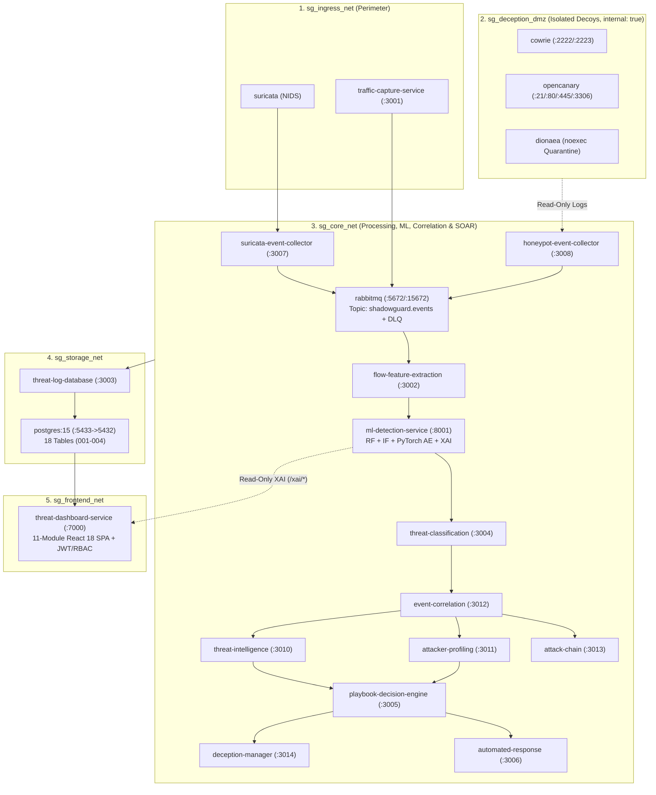
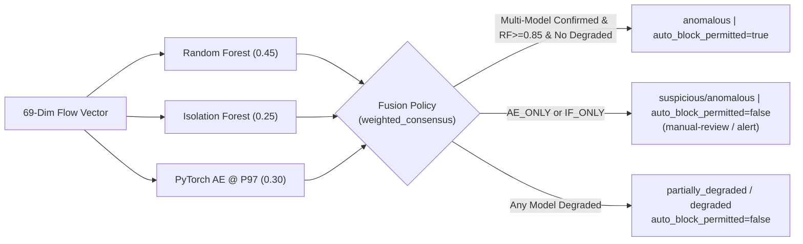

# SHADOW GUARD 2.0: AN INTELLIGENT CYBER DEFENCE, CYBER DECEPTION AND AUTOMATED INCIDENT RESPONSE PLATFORM WITH EXPLAINABLE ARTIFICIAL INTELLIGENCE

**A Major Project Report Submitted in Partial Fulfillment of the Requirements for the Degree of**  
**Bachelor of Technology (B.Tech) in Computer Science and Engineering**  
**Department of Computer Science and Engineering — Chandigarh University**

**Project Classification:** `SYNTHETIC BENCHMARK ONLY`  
**Verification Baseline:** `517 PASSED, 0 FAILED` (`node scripts/run_all_verifications.js`, 16 Suites)  
**Date:** November 16, 2026  

---

## TABLE OF CONTENTS

- **List of Figures**
- **Chapter 1 — Introduction**
- **Chapter 2 — Complete Project Overview**
- **Chapter 3 — System Architecture**
- **Chapter 4 — Technology Stack**
- **Chapter 5 — Network Event Ingestion and Processing**
- **Chapter 6 — Intrusion Detection System (Suricata NIDS)**
- **Chapter 7 — Machine Learning Detection Architecture (RF, IF, PyTorch Autoencoder)**
- **Chapter 8 — Tri-Model Fusion Engine**
- **Chapter 9 — Cyber Deception and Honeypots**
- **Chapter 10 — Threat Intelligence and Attacker Profiling**
- **Chapter 11 — Incident Correlation and MITRE ATT&CK Mapping**
- **Chapter 12 — SOAR and Automated Response**
- **Chapter 13 — Explainable Artificial Intelligence (XAI)**
- **Chapter 14 — SOC Command Center Dashboard (All 11 Modules)**
- **Chapter 15 — Database and Backend Architecture**
- **Chapter 16 — Security Architecture**
- **Chapter 17 — Installation and Setup Guide**
- **Chapter 18 — API Reference**
- **Chapter 19 — Testing and Verification**
- **Chapter 20 — Research Methodology and Dataset**
- **Chapter 21 — Performance Evaluation and Results**
- **Chapter 22 — Limitations and Future Scope**
- **Chapter 23 — Conclusion**
- **Appendices (Configurations, Event/XAI Payloads, Glossary & References)**

---

## LIST OF FIGURES

1. **Figure 1**: Module 1 — Overview Dashboard & Tri-Model Status Banner (`docs/report_assets/screenshots/dashboard/fig01_overview_dashboard.png`)
2. **Figure 2**: Module 2 — Honeypot & Adaptive Deception DMZ (`docs/report_assets/screenshots/honeypots/fig02_honeypot_deception_dmz.png`)
3. **Figure 3**: Module 3 — Attacker Behaviour Profiling & 5-Factor Risk Scoring (`docs/report_assets/screenshots/threat-intelligence/fig03_attacker_profiling.png`)
4. **Figure 4**: Module 4 — Multi-Source Sliding-Window Incident Correlation (`docs/report_assets/screenshots/incident-correlation/fig04_incident_correlation.png`)
5. **Figure 5**: Module 5 — Evidence-Based MITRE ATT&CK Kill-Chain Reconstruction (`docs/report_assets/screenshots/incident-correlation/fig05_mitre_attack_chains.png`)
6. **Figure 6**: Module 6 — Threat Intelligence Enrichment & TTL Cache (`docs/report_assets/screenshots/threat-intelligence/fig06_threat_intelligence_cache.png`)
7. **Figure 7**: Module 7 — SOAR Playbooks, Timed IP Block Leases & Allowlist (`docs/report_assets/screenshots/soar/fig07_soar_block_leases.png`)
8. **Figure 8**: Module 8 — System Health, Prometheus Metrics & Security Audit Log (`docs/report_assets/screenshots/security/fig08_system_health_security_audit.png`)
9. **Figure 9**: Module 9 — Tri-Model Detection Engine & PyTorch Autoencoder (`docs/report_assets/screenshots/ml-detection/fig09_tri_model_autoencoder.png`)
10. **Figure 10**: Module 10 — 6-Model Synthetic Benchmark & FP/FN/Collision Analysis (`docs/report_assets/screenshots/ml-detection/fig10_synthetic_benchmark_fp_fn.png`)
11. **Figure 11**: Module 11 — Explainable AI (XAI) & Threat Reasoning Overview (`docs/report_assets/screenshots/xai/fig11_xai_module11_overview.png`)
12. **Figure 12**: Module 11 — Threat Reasoning & 69-Feature 3-Scalar Transparency (`flow-atk-01404`) (`docs/report_assets/screenshots/xai/fig12_xai_threat_reasoning_3scalar.png`)
13. **Figure 13**: Module 11 — Three-Model Comparison & Random Forest TreeSHAP Waterfall (`docs/report_assets/screenshots/xai/fig13_xai_trimodel_rf_shap_waterfall.png`)
14. **Figure 14**: Module 11 — Isolation Forest Perturbation & Reference Deviation Table (`docs/report_assets/screenshots/xai/fig14_xai_isolation_forest_table.png`)
15. **Figure 15**: Module 11 — PyTorch Autoencoder Reconstruction Error vs. Frozen P97 (`docs/report_assets/screenshots/xai/fig15_xai_autoencoder_mse_p97.png`)
16. **Figure 16**: Module 11 — RBAC VIEWER Read-Only Enforcement (`docs/report_assets/screenshots/security/fig16_xai_rbac_viewer_readonly.png`)

---

## Chapter 1 — Introduction

### 1.1 Project Introduction
**Shadow Guard 2.0** is an event-driven cyber defense, cyber deception, tri-model machine learning, explainable artificial intelligence (XAI), and Security Orchestration, Automation, and Response (SOAR) platform developed as a B.Tech Computer Science and Engineering major project at Chandigarh University. The platform unifies network flow anomaly detection, signature-based Network Intrusion Detection (Suricata NIDS), isolated interactive honeypots (Cowrie, OpenCanary, Dionaea), multi-provider Threat Intelligence, behavioral attacker profiling, sliding-window incident correlation, MITRE ATT&CK kill-chain reconstruction, safety-gated SOAR containment, and an 11-module React 18 SOC Command Center.

### 1.2 Background and Motivation
Enterprise networks face multi-stage intrusions spanning Reconnaissance (`TA0043`), Initial Access (`TA0001`), Credential Access (`TA0006`), Execution (`TA0002`), Discovery (`TA0007`), Command and Control (`TA0011`), Exfiltration (`TA0010`), and Impact (`TA0040`). Relying on any single detection modality leaves severe operational blind spots:
1. Signature NIDS engines miss novel or encrypted volumetric attacks.
2. Flow-only unsupervised anomaly detectors trigger false alarms on legitimate enterprise bursts (the base-rate fallacy), making uncorroborated automatic firewall blocking hazardous.
3. Black-box ensemble alerts provide no transparent feature-level evidence for SOC analysts.

### 1.3 Problem Statement
Legacy **Shadow Guard 1.0** operated as an 11-service flow-only prototype with four structural limitations: (1) a train-serve schema mismatch (7-column offline generator vs. 69-feature runtime extractor), (2) a `max(probabilities)` confidence bug that treated `0.95` benign probability as `0.95` threat confidence, (3) zero deep packet inspection, honeypot deception, or multi-stage correlation, and (4) black-box ML decisions without XAI or SOAR non-auto-block guardrails.

### 1.4 Objectives & Scope
1. Resolve train-serve schema parity (`v2.0-69dim`, bit-exact JS/Python parity) and audit feature redundancy/collinearity.
2. Integrate an authoritative PyTorch Deep Reconstruction Autoencoder trained strictly on normal traffic (`840` flows) with validation-calibrated $P_{97} = 0.503670$ thresholding into a Tri-Model Detection Engine (`RF + IF + AE`).
3. Deploy Suricata NIDS and isolated Cowrie/OpenCanary/Dionaea honeypots (`sg_deception_dmz`) alongside Threat Intel, 5-factor profiling, `CORR-01..06` correlation, MITRE ATT&CK chains, and safety-gated SOAR.
4. Build a read-only XAI subsystem (`shap.TreeExplainer`, IF perturbation, AE MSE decomposition, `UnifiedTriModelExplainer`, PostgreSQL `004_xai_explanations.sql`, `/api/v2/xai/*`, and Dashboard Module 11) that never alters detection verdicts or SOAR guardrails.

### 1.5 Project Contributions
1. **Bit-Exact 69-Feature Parity & Collinearity Audit** (`shared/ml/feature_schema.py` & `flow-feature-extraction-service`).
2. **Leak-Free PyTorch Autoencoder & Tri-Model Fusion** raising label-free unsupervised recall (`IF + AE`) from `49.50%` to `69.31%` on `test_set` and reducing Cohort E 500-event FPR from `4.29%` to `2.14%` (`99.40%` accuracy, `0` benign auto-blocks).
3. **Model-Faithful Read-Only XAI (Stages 1–6)** with `0/384` decision mismatches and `517/517` passing verification assertions.

---

## Chapter 2 — Complete Project Overview

Shadow Guard 2.0 serves **SOC Analysts (`SOC_ANALYST`)**, **Security Administrators (`ADMIN`)**, and **Read-Only Auditors (`VIEWER`)**. A typical SOC analyst workflow progresses from perimeter capture (`traffic-capture-service`, `suricata`) $\to$ feature extraction (`v2.0-69dim`) $\to$ Tri-Model scoring (`ml-detection-service`) $\to$ multi-sensor correlation (`CORR-01..06`) and MITRE kill-chain assembly $\to$ XAI investigation in **Module 11** (`RF TreeSHAP`, `IF Perturbation`, `AE MSE vs. P97`) $\to$ safety-gated SOAR containment (`PB-SOAR-01..05` with timed leases and `AE_ONLY` non-auto-block locks).

---

## Chapter 3 — System Architecture

Shadow Guard 2.0 defines **22 containerized services** across **5 isolated Docker bridge networks** (`sg_ingress_net`, `sg_core_net`, `sg_deception_dmz`, `sg_storage_net`, `sg_frontend_net`):



---

## Chapter 4 — Technology Stack

| Component | Technology & Version | Rationale |
| :--- | :--- | :--- |
| **Backend Services** | Node.js + Express (`4.18.2`) + Zero-Dep Fallback | High-concurrency asynchronous I/O for event collectors, correlation, and API gateway |
| **ML & XAI Service** | Python `3.14.7`, FastAPI (`0.115.0`), Uvicorn (`0.30.6`) | Native Python ecosystem for PyTorch, scikit-learn, and SHAP |
| **Deep Learning** | PyTorch (`2.15.0+cpu`) | Deterministic (`manual_seed(42)`) Autoencoder training, `MSELoss`, and `.pt` persistence |
| **Classical ML** | scikit-learn (`1.9.1`), NumPy (`2.5.4`), SciPy (`1.18.1`) | `RandomForestClassifier`, `IsolationForest`, `StandardScaler`, `RobustScaler` |
| **Explainable AI** | `shap` (`0.54.1` `TreeExplainer`) | Official exact polynomial-time Shapley attribution for tree ensembles |
| **Frontend UI** | React 18 (UMD + Babel), WebSocket (`ws`), CSS3 | Modular 11-tab SOC Command Center with live telemetry and XAI visualizations |
| **Message Broker** | RabbitMQ (`3.13-management-alpine`) | Durable AMQP topic exchange (`shadowguard.events`) with Dead-Letter Queues |
| **Database** | PostgreSQL `15` (`pgcrypto`, JSONB, B-Tree & GIN) | ACID transactions, structured JSONB storage for telemetry and XAI attributions |
| **NIDS & Decoys** | Suricata, Cowrie, OpenCanary, Dionaea | Defense-in-depth packet inspection and zero-false-positive deception traps |
| **Observability** | Prometheus `/metrics`, `securityAuditLog` | Real-time counters/gauges and immutable RBAC audit trail |

---

## Chapter 5 — Network Event Ingestion and Processing

1. **Flow Capture & Canonical Extraction**: `traffic-capture-service` captures flow tuples `(packets, bytes, duration)` and publishes `event.network.*` messages over RabbitMQ (`shadowguard.events`). `flow-feature-extraction-service` transforms these into canonical `v2.0-69dim` vectors (`max_abs_diff = 0.0` vs. Python `shared/ml/feature_schema.py`).
2. **Event Contract v2**: Standardizes `event_id` (UUID v4), `correlation_id`, `timestamp`, `source_service`, `event_type`, `source_ip`, `destination_ip`, `severity`, `confidence`, and typed metadata blocks (`nids_metadata`, `honeypot_metadata`, `ml_metadata`, `threat_intel_metadata`).
3. **Error Handling & DLQ**: Malformed payloads or database errors trigger RabbitMQ `nack(requeue=false)` routing to `shadowguard.dlx` dead-letter queues, while invalid ML feature vectors return explicit `degraded` status (`recommended_action = "manual-review"`, `auto_block_permitted = false`).

---

## Chapter 6 — Intrusion Detection System (Suricata NIDS)

Suricata (`jasonish/suricata:latest`) inspects ingress traffic on `sg_ingress_net` using `suricata/suricata.yaml` and `suricata/rules/local.rules` (`SID 2100001–2100010`), emitting `eve.json` records across `alert`, `dns`, `http`, `tls`, and `flow` event types. `suricata-event-collector-service` (`:3007`) reads `eve.json` over a read-only mount and normalizes alerts into Event Contract v2. **Limitation**: Signature NIDS cannot inspect encrypted payloads without TLS decryption and depends on rule coverage.

---

## Chapter 7 — Machine Learning Detection Architecture

All three models operate on the canonical `v2.0-69dim` feature vector derived from `(packets, bytes, duration)`.

### 7.1 Supervised Random Forest Classifier (`models/random_forest_69_v2.pkl`)
- **Architecture & Training**: `150` CART decision trees trained on `960` flows (`840` `train_normal` + `120` `supervised_attack_train`) with `StandardScaler` preprocessing, `classes_ = [0, 1]`, and threshold `0.50`.
- **Legacy Bug Fix**: Explicitly extracts `attack_probability = P(class=1 | x)` instead of `max(probabilities)` (which previously treated `0.95` benign confidence as `0.95` threat confidence).
- **Held-Out (`384` flows) Metrics**: Accuracy `97.14%`, Precision `99.48%`, Recall `95.05%`, F1 `0.9722`, FPR `0.55%`, ROC-AUC `0.9933`.

### 7.2 Unsupervised Isolation Forest (`models/isolation_forest_69_v2.pkl`)
- **Architecture & Training**: `150` random isolation trees trained strictly on `840` normal flows (`StandardScaler`, `best_threshold = -0.024499`).
- **Score Semantics**: `raw_decision_score < -0.024499` indicates shorter average path length in random partition trees. Normalized monotonically via $s_{\text{IF}}(\mathbf{x}) = \sigma((\tau_{\text{IF}} - d_{\text{raw}}(\mathbf{x})) / 0.08) \in [0, 1]$. **This is an unsupervised isolation metric, NOT a probability.**
- **Held-Out (`384` flows) Metrics**: Accuracy `72.92%`, Precision `98.04%`, Recall `49.50%`, F1 `0.6579`, FPR `1.10%` (`100%` on `ddos_flood`/`data_exfiltration`/`multi_vector`, `0.00%` on `c2_beaconing`/`port_scan`).

### 7.3 Authoritative PyTorch Deep Reconstruction Autoencoder (`models/autoencoder_model.pt`)
- **Preprocessing (`FeaturePreprocessor`, `models/autoencoder_preprocessor.pkl`)**: Validates 69 finite floats $\to$ `signed_log1p` on heavy-tailed indices $\to$ `RobustScaler(25, 75)` fitted strictly on `840` `train_normal` flows $\to$ `clip[-10.0, 10.0]`.
- **Neural Architecture (`FlowAutoencoder`)**:
  $$\mathbb{R}^{69} \xrightarrow{\text{ReLU}} 32 \xrightarrow{\text{ReLU}} 16 \xrightarrow{\text{ReLU}} 8 \text{ (Bottleneck)} \xrightarrow{\text{ReLU}} 16 \xrightarrow{\text{ReLU}} 32 \xrightarrow{\text{Linear}} \mathbb{R}^{69}$$
  Trained for `120` epochs (`Adam`, `lr=0.002`, `weight_decay=1e-5`, `best_epoch=114`, `best_val_mse=0.141353`).
- **Reconstruction Error & Validation Calibration**: $\text{MSE}(\mathbf{z}) = \frac{1}{69}\sum_{j=0}^{68}(z_j - \hat{z}_j)^2$ (**NOT a probability**). Calibrated strictly on `val_normal` (`180` flows):
  - $P_{95} = 0.409105$ (`5.00%` val FPR $\to$ `suspicious` warning tier)
  - **$P_{97} = 0.503670$** (**`3.33%` val FPR $\to$ frozen primary threshold**, satisfying $\le 3.5\%$ SOC budget)
  - $P_{99} = 0.645935$ (`1.11%` val FPR $\to$ critical tier)
- **Held-Out (`384` flows) @ P97**: Accuracy `76.30%`, Precision `96.64%`, Recall `56.93%`, F1 `0.7165`, FPR `2.20%`, ROC-AUC `0.9652` (recovering `76.00%` of `c2_beaconing` and `56.67%` of `port_scan`).

---

## Chapter 8 — Tri-Model Fusion Engine

Implemented in `shared/ml/tri_model_fusion.py` (`TriModelDetectionEngine`), the fusion engine combines all three detectors while keeping **Detection**, **Explanation**, and **SOAR Response Authorization** strictly separate:



- **`weighted_consensus` (Frozen Default)**: `96.88%` accuracy, `97.98%` precision, `96.04%` recall, `0.9700` F1, `2.20%` FPR (`TN=178, FP=4, FN=8, TP=194`). All 4 `AE_ONLY` normal FPs have `auto_block_permitted = false`.
- **`unsupervised_ensemble` (`IF OR AE@P97`)**: `82.29%` accuracy, `95.89%` precision, `69.31%` recall, `0.8046` F1 (`auto_block_permitted = false`).
- **`majority_vote` ($\ge 2$ of 3 agree)**: `92.71%` accuracy, `100.00%` precision, `86.14%` recall, `0.00%` FPR.

---

## Chapter 9 — Cyber Deception and Honeypots

Isolated inside `sg_deception_dmz` (`internal: true`, no gateway to `sg_storage_net`):
- **Cowrie (`:2222`, `:2223`)**: SSH/Telnet decoy capturing brute-force usernames and shell commands with **zero plaintext/hash password retention**.
- **OpenCanary (`:21`, `:80`, `:445`, `:3306`)**: Multi-protocol decoy traps detecting internal lateral enumeration.
- **Dionaea (`:42`, `:135`, `:445`, `:1433`)**: Malware capture trap writing binaries to a `noexec,nosuid,nodev` mount and emitting SHA-256 hashes.


*Figure 2: Live Module 2 UI showing Cowrie, OpenCanary, and Dionaea decoy statuses, adaptive deception directives (`DEC-01..DEC-04`), and zero-password deception telemetry (synthetic/simulated stream).*

---

## Chapter 10 — Threat Intelligence and Attacker Profiling

- **Threat Intelligence (`threat-intelligence-service`, `:3010`)**: Queries AbuseIPDB, VirusTotal v3, AlienVault OTX, and local IOC catalogs with TTL caching (`threat_intel_cache`).
- **Attacker Profiling (`attacker-profiling-service`, `:3011`)**: Computes an explainable **5-Factor Risk Score (`0–100`)** across honeypot depth, auth abuse, 7 suspicious command regexes (`PAYLOAD_DOWNLOADER`, `REVERSE_SHELL`, etc.), IOC reputation, and ML/NIDS severity, with an explicit NAT/VPN/botnet indicator disclaimer.


*Figure 3: Live Module 3 UI displaying per-IP behavioral profiles and 5-factor explainable risk scores.*


*Figure 6: Live Module 6 UI displaying cached Threat Intelligence IOCs, confidence scores, and TTL timers.*

---

## Chapter 11 — Incident Correlation and MITRE ATT&CK Mapping

- **`EventCorrelationEngine` (`CORR-01..06`, `:3012`)**: Redis-free 15-minute in-memory sliding window with 2-second SHA-1 burst deduplication. Consolidates `363` Cohort E raw alerts into `5` coordinated incidents (`98.62%` queue consolidation, distinct from FPR reduction).
- **`attack-chain-service` (`:3013`)**: Reconstructs MITRE ATT&CK kill chains across **`OBSERVED`**, **`INFERRED`**, and **`SUSPECTED`** certainty tiers.


*Figure 4: Live Module 4 UI showing correlated multi-source incidents (`CORR-01`, `CORR-02`, `CORR-04`) fusing NIDS, Honeypot, and ML telemetry.*


*Figure 5: Live Module 5 UI showing chronological MITRE ATT&CK kill-chain stages with `OBSERVED`, `INFERRED`, and `SUSPECTED` epistemic badges.*

---

## Chapter 12 — SOAR and Automated Response

- **Adaptive Deception (`DEC-01..04`)** & **SOAR Playbooks (`PB-SOAR-01..05`)**:
  - `PB-SOAR-01` (`risk >= 80`, `CRITICAL`, honeypot/payload): 60-min IP block lease + `DEC-04` + Tier-3 escalation.
  - `PB-SOAR-02` (`offenses >= 3`, `intel >= 85`): 120-min block + `BLOCK_IP_PERMANENT` (**requires human `ADMIN` approval**).
  - `PB-SOAR-03` (`conf >= 0.85`, `risk >= 60`, `HIGH/CRITICAL`): 30-min block lease + `DEC-01`.
  - `PB-SOAR-04`: Deception lure + alert. `PB-SOAR-05`: Monitor only.
- **Safety Guardrails**: Immutable critical allowlist, timed block leases, rollback, and strict **`AE_ONLY` / `IF_ONLY` / `degraded` non-auto-block enforcement** (`0/3` benign internal IPs blocked in Cohort E).


*Figure 7: Live Module 7 UI displaying SOAR playbook executions, pending manual approvals, active timed IP block leases with rollback, and the immutable critical allowlist.*

---

## Chapter 13 — Explainable Artificial Intelligence (XAI)

Implemented as a read-only subsystem across `shared/ml/xai_explainer.py` and `shared/ml/unified_xai_engine.py`:
1. **Random Forest (`RandomForestSHAPExplainer`)**: Official `shap.TreeExplainer` (`shap == 0.54.1`) over `StandardScaler` + `RandomForestClassifier.predict_proba` (`classes_ = [0, 1]`). Satisfies exact additivity $P_{\text{RF}}(\text{attack}\mid \mathbf{x}) = \mathbb{E}[P_{\text{RF}}(\text{attack})] + \sum_{j=0}^{68}\phi_j^{(1)}(\mathbf{x})$ with $\max|\text{err}| = 8.88 \times 10^{-16}$ across `384` flows. **SHAP values are feature attributions, not causal proof.**
2. **Isolation Forest (`IsolationForestAnomalyExplainer`)**: `reference_population_perturbation_and_quantile_deviation` replacing features with `840`-flow `train_normal` medians (`bootstrap Spearman = 0.9878`, validated against `shap.TreeExplainer(if_model)`). Explains the unsupervised isolation score (**NOT a probability**).
3. **PyTorch Autoencoder (`AutoencoderReconstructionExplainer`)**: Decomposes MSE into 69 per-feature squared errors $(z_j - \hat{z}_j)^2$ vs. frozen $P_{97} = 0.503670$ ($P_{95}=0.409105, P_{99}=0.645935$, **NOT a probability**).
4. **3-Scalar Grouping & Stability (`ThreeScalarMeasurementGrouper` + `UnifiedTriModelExplainer`)**: Groups 69 correlated features into `(packets, bytes, duration)` shares, never averages SHAP/IF/AE scales, and handles partial/complete unavailability (`healthy`, `partially_degraded`, `degraded`).


*Figure 12: Live Module 11 investigation of `flow-atk-01404` showing non-causal threat reasoning, reliability tier `HIGH_UNANIMOUS_CONSENSUS`, and 69-feature 3-scalar transparency (`packets=36.6%`, `bytes=22.7%`, `duration=40.8%`).*


*Figure 13: Live Module 11 Three-Model Comparison table (preserving distinct scales) and Random Forest TreeSHAP positive/negative waterfall bars + global importance.*


*Figure 14: Live Module 11 Isolation Forest reference-population perturbation table (`840` normal flows, threshold `-0.024499`, robust Z-scores).*


*Figure 15: Live Module 11 Autoencoder reconstruction error panel (`MSE=1.020173` vs. frozen `P97=0.503670`), ranked top-5 bar chart, and original vs. reconstructed Z table.*

---

## Chapter 14 — SOC Command Center Dashboard (All 11 Modules)

Served by `threat-dashboard-service/server.js` (`:7000`, React 18 SPA in `public/app.js` + `styles.css`):

| Module | Purpose & Information Displayed | Consumed APIs | User Actions & RBAC |
| :--- | :--- | :--- | :--- |
| **1. Overview Dashboard** | Tri-Model status banner, 6 KPI tiles, service health, ML artifact specs, recent threats | `/api/v2/soc/overview`, `/api/v2/soc/ml/overview`, `/api/statistics` | Navigate to Tri-Model/XAI (`VIEWER`+) |
| **2. Honeypot & Deception** | Cowrie, OpenCanary, Dionaea decoys, `DEC-01..04` directives, zero-password telemetry | `/api/v2/soc/overview` | Simulate decoy events, rollback directives (`SOC_ANALYST`+) |
| **3. Attacker Profiling** | Per-IP 5-factor risk scores (`0–100`), behavioral tags, indicator disclaimer | `/api/v2/soc/overview` | Inspect IP risk breakdown (`VIEWER`+) |
| **4. Incident Correlation** | Correlated incidents (`CORR-01..06`), event lineage, queue consolidation | `/api/v2/soc/overview` | Update incident status (`SOC_ANALYST`+) |
| **5. MITRE Attack Chains** | Chronological kill-chain stages (`OBSERVED`, `INFERRED`, `SUSPECTED`) | `/api/v2/soc/overview` | Inspect tactic/technique timeline (`VIEWER`+) |
| **6. Threat Intelligence** | Cached IOC reputation, provider tags, TTL expiration | `/api/v2/soc/overview` | Inspect IOC matches (`VIEWER`+) |
| **7. SOAR & Block Leases** | Playbook executions, pending approvals, active leases, critical allowlist | `/api/v2/soc/overview` | Rollback lease (`SOC_ANALYST`+), Approve permanent ban (`ADMIN`) |
| **8. System & Security Audit** | Service liveness, `/metrics` Prometheus link, `securityAuditLog` | `/api/services/health`, `/api/v2/security/audit`, `/metrics` | Inspect audit trail (`VIEWER`+) |
| **9. Tri-Model & Autoencoder** | 384-flow severity breakdown, policy selector, `AE_ONLY` manual review queue | `/api/v2/soc/ml/overview`, `/detections`, `/manual-review` | Switch fusion policy, decide manual review (`SOC_ANALYST`+), degraded test (`ADMIN`) |
| **10. Synthetic Benchmark & FP/FN** | 6-model comparison, P95/P97/P99 calibration, FP/FN/Collision views | `/api/v2/soc/ml/evaluation`, `/research-benchmark` | Inspect synthetic benchmark (`VIEWER`+) |
| **11. Explainable AI & Threat Reasoning** | API-backed XAI overview, flow search, RF SHAP, IF perturbation, AE MSE, 3-model comparison, 3-scalar transparency | `/api/v2/xai/overview`, `/explanation/:flowId`, `POST /explanation`, `/diagnostics` | Investigate GET (`VIEWER`+), Request fresh POST (`SOC_ANALYST`+), Diagnostics (`ADMIN`) |


*Figure 1: Live Module 1 Overview Dashboard showing Tri-Model Engine status (`P97 = 0.50367`), KPI tiles, and ML model specs (synthetic stream).*


*Figure 8: Live Module 8 UI showing microservice health, Prometheus `/metrics`, and RBAC `securityAuditLog`.*


*Figure 9: Live Module 9 UI displaying Tri-Model severity distribution, agreement breakdown, and detection timeline (`384` held-out synthetic flows).*


*Figure 10: Live Module 10 UI displaying the `SYNTHETIC BENCHMARK ONLY` 6-model comparison, P95/P97/P99 sweep, and FP/FN/collision views.*


*Figure 11: Live Module 11 initial overview showing real API-backed XAI counters, recent activity filters, and flow search controls.*

---

## Chapter 15 — Database and Backend Architecture

- **PostgreSQL 15 (`database/init.sql` + `migrations/001`–`004`)**: **18 tables** (`threat_logs`, 17 v2 core tables across `002_schema_v2_core.sql`, and `xai_explanations` in `004_xai_explanations.sql`).
- **`xai_explanations` (`004_xai_explanations.sql`)**: Stores `explanation_id`, `flow_id`, `input_signature_sha256`, `fusion_policy`, `feature_schema_version`, JSONB columns for `rf_shap_contributions`, `if_attribution`, `ae_reconstruction_errors`, `unified_model_agreement`, `analyst_explanation`, B-Tree indexes (`flow_id`, `status`, `created_at DESC`), GIN indexes (`unified_model_agreement`, `final_tri_model_classification`), and `CONSTRAINT uq_xai_flow_policy_signature UNIQUE (flow_id, fusion_policy, input_signature_sha256)`.
- **Transactional Persistence & Fallback (`threat-dashboard-service/lib/xaiStore.js`)**: Executes parameterized `BEGIN` $\to$ `INSERT ... ON CONFLICT DO UPDATE` $\to$ `COMMIT`, automatically falling back to an in-memory LRU cache (`max = 256`) if PostgreSQL is unreachable.

---

## Chapter 16 — Security Architecture

- **JWT & API-Key Authentication (`threat-dashboard-service/lib/securityAndObservability.js`)**: HMAC-SHA256 signed JWTs (`Authorization: Bearer <token>`) and internal `X-API-Key` validation.
- **RBAC Hierarchy (`VIEWER: 1`, `SOC_ANALYST: 2`, `ADMIN: 3`)**: `VIEWER` sees read-only views with `src_ip`/`dst_ip`/`src_port` sanitized by `sanitizeXaiForRole()`; `SOC_ANALYST` can generate XAI explanations (`POST`) and decide manual reviews; `ADMIN` accesses `/api/v2/xai/diagnostics` and permanent block approvals.
- **Rate Limiting, Validation & Audit**: Per-IP rate limiting (`300` req/min default), regex `flow_id` validation (`^[A-Za-z0-9_.:-]{1,128}$`), 69-float finiteness validation, and immutable `securityAuditLog` tracking `AUTH_MISSING`, `AUTH_FAILURE`, `RBAC_DENIED`, and `XAI_*` events.


*Figure 16: Live Module 11 UI under `RBAC: VIEWER (Read-Only)` showing the `POST` fresh explanation button removed and replaced by the read-only lock indicator.*

---

## Chapter 17 — Installation and Setup Guide

Every command and port below is verified directly against `package.json`, `requirements.txt`, `docker-compose.yml`, and service entrypoints.

### 17.1 Prerequisites
- **OS**: Windows 10/11 (native Node.js/Python host verification) or Linux (recommended for full Docker Compose + Suricata + honeypots).
- **Node.js**: `18+` with `npm`.
- **Python**: `3.11+` (verified on `3.14.7`) with `pip`.
- **Optional Full Mesh**: Docker Engine + Docker Compose (`docker-compose.yml`).

### 17.2 Step-by-Step Native Setup & Startup
1. **Clone & Enter Repository**:
   ```bash
   git clone <repository-url>
   cd ShadowGuard-main
   ```
2. **Python Virtual Environment & Dependencies**:
   ```bash
   python -m venv .venv
   # Windows PowerShell: .\.venv\Scripts\Activate.ps1
   # Linux/macOS: source .venv/bin/activate
   pip install -r ml-detection-service/requirements.txt
   ```
   *(Installs `fastapi==0.115.0`, `uvicorn==0.30.6`, `scikit-learn>=1.5.0`, `pandas>=2.2.0`, `numpy>=1.26.0`, `requests==2.32.3`, `torch>=2.2.0`, `shap>=0.54.0`.)*
3. **Node.js Dashboard Dependencies**:
   ```bash
   cd threat-dashboard-service
   npm install
   cd ..
   ```
4. **Verify Model & Dataset Artifacts Exist**:
   Confirm `models/random_forest_69_v2.pkl`, `models/isolation_forest_69_v2.pkl`, `models/autoencoder_model.pt`, `models/autoencoder_preprocessor.pkl`, `models/autoencoder_metadata.json`, and `data/autoencoder_flow_dataset_v2.json` are present.
5. **Start Python ML & XAI Detection Service (Port `8001`)**:
   ```powershell
   # Windows PowerShell
   $env:PORT='8001'; python ml-detection-service/main.py
   ```
   ```bash
   # Linux/macOS
   PORT=8001 python ml-detection-service/main.py
   ```
   Verify health: `curl http://127.0.0.1:8001/health` and `curl http://127.0.0.1:8001/xai/health`.
6. **Start Node.js SOC Dashboard & API Gateway (Port `7000`)**:
   ```powershell
   # Windows PowerShell (standalone mode with in-memory XAI LRU fallback if PostgreSQL is not running)
   $env:PORT='7000'; $env:ML_DETECTION_URL='http://127.0.0.1:8001'; $env:DISABLE_XAI_PG='true'; node threat-dashboard-service/server.js
   ```
   Verify health: `curl http://127.0.0.1:7000/health`, then open `http://127.0.0.1:7000` in a browser.
7. **PostgreSQL & RabbitMQ (Docker Compose on Linux / Docker-enabled Host)**:
   - `docker-compose.yml` configures `postgres:15` on host port `5433` (init script `./database/init.sql`), `rabbitmq:3.13-management-alpine` on `5672`/`15672`, and all 22 services (`docker compose up --build`).
   - Apply `004_xai_explanations.sql` against PostgreSQL 15: `psql -h 127.0.0.1 -p 5433 -U user -d threat_logs -f database/migrations/004_xai_explanations.sql`.
   - *Host Blocker Disclosure*: Docker Desktop/CLI was not running on the Windows evaluation host, so live multi-container `docker compose up` and live `postgres:15` migration execution remain unverified on this host.

---

## Chapter 18 — API Reference

- **Python ML & XAI Service (`:8001`)**:
  - `GET /health`, `GET /model/autoencoder/info`, `POST /model/reload`
  - `POST /detect`, `POST /detect/autoencoder`, `POST /detect/tri-model`
  - `GET /xai/health` (`200`), `POST /xai/explain` (`200`, `400`, `404`), `POST /xai/explain/batch` (`200`, `400`, max `50` items)
- **Node.js SOC Gateway (`:7000`)**:
  - `POST /api/v2/auth/token`, `GET /api/v2/security/audit` (`VIEWER`+), `GET /metrics`
  - `GET /api/v2/soc/overview` (`VIEWER`+), `GET /api/v2/soc/ml/overview`, `/detections`, `/detections/:flowId`, `/evaluation`, `/manual-review`, `/research-benchmark` (`VIEWER`+)
  - `POST /api/v2/soc/ml/manual-review/:flowId/decision`, `/fusion-policy` (`SOC_ANALYST`+); `POST /api/v2/soc/ml/degraded-mode`, `/reload` (`ADMIN`)
  - `GET /api/v2/xai/overview` (`VIEWER`+), `GET /api/v2/xai/explanation/:flowId` (`VIEWER`+ with IP sanitization), `POST /api/v2/xai/explanation` (`SOC_ANALYST`+), `POST /api/v2/xai/explanation/batch` (`SOC_ANALYST`+), `GET /api/v2/xai/diagnostics` (`ADMIN`; returns `503`/`504` on ML offline/timeout).

---

## Chapter 19 — Testing and Verification

Executed `node scripts/run_all_verifications.js` across all **16 suites**, achieving **`517 PASSED, 0 FAILED`**:

| Stage / Suite | Passed | Failed | Verification Mode |
| :--- | :---: | :---: | :--- |
| **Core Stages 2–7** (Foundation, Deception, Intel/Corr, SOAR, Dashboard/RBAC, Cohort A–D) | `267` | `0` | Automated unit + in-process + benchmark |
| **Autoencoder Stages 1–5** (69-Schema Parity, PyTorch Training/P97, Live ML HTTP, Dashboard, Cohort E) | `153` | `0` | Python/Node runtime + live HTTP ML tests |
| **XAI Stages 1–5** (TreeSHAP/IF/AE Core, Unified 384-Flow Invariance, API/RBAC/PG Store, Module 11 UI, Stability/Latency) | `97` | `0` | Python unit (`27` tests across 3 files) + in-process Express/Python bridge + mocked `pg` Pool/`memory_fallback` |
| **GRAND TOTAL** | **`517`** | **`0`** | **Zero regressions; `0/384` held-out flow mismatches** |

---

## Chapter 20 — Research Methodology and Dataset

- **Dataset Origin (`SYNTHETIC BENCHMARK ONLY`)**:
  - **Track 2 (`data/autoencoder_flow_dataset_v2.json`, `seed=42`)**: `1,535` parametrically generated records across `6` normal enterprise profiles and `8` attack categories (`c2_beaconing`, `data_exfiltration`, `ddos_flood`, `multi_vector`, `novel_stealth_anomaly`, `port_scan`, `service_enum`, `ssh_brute_force`). After removing `5` exact duplicates and quarantining `6` corrupted/contradictory records, `1,524` clean records are partitioned with `zero_hash_overlap_verified = true` into `train_normal` (`840`), `val_normal` (`180`), `supervised_attack_train` (`120`), and unseen `test_set` (`384`: `182` normal + `202` attack + `4` preserved cross-label feature collisions).
  - **Track 1 (`500` Multi-Source System Events, `Mulberry32(20261113)`)**: `10` scenarios (`S01_NORMAL_TRAFFIC` `140` events, `S02–S10` `40` events each = `360` attacks) pairing deterministic NIDS/honeypot/IOC events with unfiltered `test_set` flows.
- **69-Feature Schema Audit**: All 69 features derive from `(packets, bytes, duration)`, with `13` duplicate polynomial columns (`f_25..f_39`) and `14` collinear harmonic padding columns (`f_55..f_68`).

---

## Chapter 21 — Performance Evaluation and Results

> **Note:** Track 1 (`N=500` system events) and Track 2 (`N=384` held-out flows) are distinct synthetic benchmarks and are reported separately below.

### 21.1 Track 2: 384 Held-Out Flow Evaluation (`test_set`)

| Model / Policy | TN | FP | FN | TP | Accuracy | Precision | Recall | F1 | FPR | ROC-AUC |
| :--- | :---: | :---: | :---: | :---: | :---: | :---: | :---: | :---: | :---: | :---: |
| **Random Forest** (`random_forest_69_v2`) | 181 | 1 | 10 | 192 | 97.14% | 99.48% | 95.05% | 0.9722 | 0.55% | 0.9933 |
| **Isolation Forest** (`isolation_forest_69_v2`) | 180 | 2 | 102 | 100 | 72.92% | 98.04% | 49.50% | 0.6579 | 1.10% | 0.9109 |
| **PyTorch AE @ P95** (`0.409105`) | 176 | 6 | 64 | 138 | 81.77% | 95.83% | 68.32% | 0.7977 | 3.30% | 0.9652 |
| **PyTorch AE @ P97** (`0.503670`, **Primary**) | 178 | 4 | 87 | 115 | 76.30% | 96.64% | 56.93% | 0.7165 | 2.20% | 0.9652 |
| **PyTorch AE @ P99** (`0.645935`) | 181 | 1 | 105 | 97 | 72.40% | 98.98% | 48.02% | 0.6467 | 0.55% | 0.9652 |
| **IF + AE Unsupervised Ensemble** | 176 | 6 | 62 | 140 | **82.29%** | 95.89% | **69.31%** | **0.8046** | 3.30% | — |
| **Tri-Model `majority_vote`** | 182 | 0 | 28 | 174 | 92.71% | **100.00%** | 86.14% | 0.9255 | **0.00%** | — |
| **Tri-Model `weighted_consensus`** | 178 | 4 | 8 | 194 | **96.88%** | 97.98% | **96.04%** | **0.9700** | 2.20% | — |

### 21.2 Track 1: 500-Event System Ablation (Cohorts A–E) & Cohort E Ablation

| Cohort | Accuracy | Precision | Recall | F1 | FPR | Alert Consolidation | Benign Auto-Blocks |
| :--- | :---: | :---: | :---: | :---: | :---: | :---: | :---: |
| **Cohort A** (`SG 1.0 Flow ML`) | 66.40% | 90.00% | 60.00% | 72.00% | 17.14% | 0.00% (`240->240`) | N/A |
| **Cohort B** (`+ Suricata NIDS`) | 80.60% | 95.50% | 76.67% | 85.05% | 9.29% | 0.00% (`289->289`) | N/A |
| **Cohort C** (`+ Honeypots`) | 90.60% | 96.17% | 90.56% | 93.28% | 9.29% | 0.00% (`339->339`) | N/A |
| **Cohort D** (`Complete RF+IF`) | 98.80% | 98.36% | 100.00% | 99.17% | 4.29% | 98.63% (`366->5`) | — |
| **Cohort E (`+ PyTorch AE + Tri-Model`)** | **99.40%** | **99.17%** | **100.00%** | **99.59%** | **2.14%** | **98.62% (`363->5`)** | **0 / 3** |

*Ablation Findings*: Disabling honeypots drops Cohort E recall to `96.39%` (`FN = 13`); disabling SOAR guardrails causes `3` erroneous automatic IP blocks on benign internal hosts.

### 21.3 XAI Stage 5 Evaluation (`evaluate_xai_stage5.py`)
- **SHAP Additivity (`384` flows)**: Max error = **`8.88e-16`**, mean = `7.01e-16`.
- **Isolation Forest Reference Stability (`30` flows, 50% bootstrap `840 -> 420`)**: Spearman $\rho = \mathbf{0.9878}$, Top-5 Jaccard = `0.9889`.
- **Perturbation Stability (`30` flows $\times 3 = 90$ cases; `0/30` repeat mismatches)**: For `89` decision-preserving cases, Top-5 Jaccard / Spearman $\rho$ / 3-Scalar L1 shift = **`0.8482 / 0.9574 / 0.0054`** (RF), **`0.6096 / 0.8595 / 0.0200`** (IF), **`0.5728 / 0.7431 / 0.0216`** (AE).
- **Attribution Bias (`60` flows)**: Redundant columns (`f_25..f_39` + `f_55..f_68`) absorbed **`42.79%`** (RF) and **`51.28%`** (IF) vs. **`8.63%`** (AE).
- **Computational Latency (`n = 100` flows, Python `3.14.7`, Windows 11)**: Median = `19.25 ms` (RF), `37.93 ms` (IF), `1.74 ms` (AE), `94.19 ms` (Unified, `P95 = 111.01 ms`, `P99 = 113.16 ms`), `0.911 MB` peak memory (20-flow batch).

---

## Chapter 22 — Limitations and Future Scope

1. **Synthetic-Only Benchmark**: No real-world PCAP generalization (CIC-IDS2017, UNSW-NB15) has been established.
2. **3-Scalar Feature Manifold**: `v2.0-69dim` derives from `(packets, bytes, duration)` with 13 duplicate and 14 collinear columns; future work should adopt bidirectional CICFlowMeter/NFStream L3/L4/L7 features.
3. **XAI Non-Causality & Non-Probability**: SHAP explains model behavior, not causal root causes; IF scores and AE MSE are not probabilities.
4. **Host Verification Gaps**: Live `docker compose up` and live `postgres:15` migration execution (`004_xai_explanations.sql`) remain unverified on the Windows host without a Docker daemon (all 11 dashboard modules and XAI endpoints were verified live against the native Python/Node services on ports `8001` and `7000`).

---

## Chapter 23 — Conclusion

Shadow Guard 2.0 demonstrates a complete, safety-gated cyber defense, cyber deception, tri-model machine learning, and explainable AI platform. Across controlled synthetic benchmarks, the PyTorch Autoencoder boosts label-free unsupervised recall from `49.50%` to `69.31%`, Cohort E achieves `99.40%` accuracy (`2.14%` FPR, `0` benign IP auto-blocks), and the read-only XAI subsystem (`TreeSHAP`, perturbation attribution, MSE decomposition, and Module 11 UI) achieves `0/384` decision mismatches across `517/517` passing verification assertions.

---

## Appendices

### Appendix A — Sample Unified XAI Explanation Output (`flow-atk-01404`)
```json
{
  "flow_id": "flow-atk-01404",
  "explanation_generation_status": "healthy",
  "final_tri_model_classification": {
    "fusion_policy": "weighted_consensus",
    "final_decision": "anomalous",
    "recommended_action": "block",
    "auto_block_permitted": true,
    "decision_rule": "MULTI_MODEL_CONFIRMED_THREAT"
  },
  "random_forest_explanation": { "is_exact_shap": true, "attack_probability": 1.0, "additivity_error": 6.66e-16 },
  "isolation_forest_explanation": { "score_semantics": "UNSUPERVISED_ANOMALY_SCORE_NOT_PROBABILITY", "raw_decision_score": -0.187317, "anomaly_score": 0.884446 },
  "autoencoder_explanation": { "score_semantics": "RECONSTRUCTION_ERROR_MSE_NOT_PROBABILITY", "reconstruction_error": 1.020173, "threshold": 0.50367 }
}
```

### Appendix B — Glossary
- **AE_ONLY**: Flow flagged solely by the PyTorch Autoencoder (`auto_block_permitted` strictly `false`).
- **P97 (`0.503670`)**: Frozen 97th-percentile validation threshold calibrated on `180` normal flows (`3.33%` val FPR).
- **TreeSHAP**: Exact polynomial-time Shapley attribution algorithm for tree ensembles (Lundberg et al., 2020).

### Appendix C — References
1. Breiman, L. (2001). Random forests. *Machine Learning*, 45(1), 5–32.
2. Liu, F. T., Ting, K. M., & Zhou, Z.-H. (2008). Isolation forest. *IEEE ICDM*, 413–422.
3. Hinton, G. E., & Salakhutdinov, R. R. (2006). Reducing the dimensionality of data with neural networks. *Science*, 313(5786), 504–507.
4. Lundberg, S. M., & Lee, S.-I. (2017). A unified approach to interpreting model predictions. *NeurIPS*, 30, 4765–4774.
5. Lundberg, S. M., et al. (2020). From local explanations to global understanding with explainable AI for trees. *Nature Machine Intelligence*, 2(1), 56–67.
6. Axelsson, S. (2000). The base-rate fallacy and the difficulty of intrusion detection. *ACM TISSEC*, 3(3), 186–205.
7. Sommer, R., & Paxson, V. (2010). Outside the closed world: On using machine learning for network intrusion detection. *IEEE S&P*, 305–316.
8. Open Information Security Foundation (2024). *Suricata User Guide & EVE JSON Format*.
9. MITRE Corporation (2023). *MITRE ATT&CK Enterprise Matrix*.
