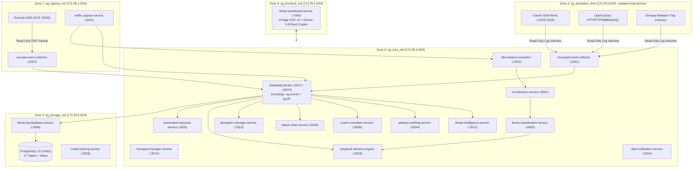

# Shadow Guard 2.0 — Technical Architecture, Engineering & Academic Research Manual

> [!NOTE]
> **Historical Baseline & Current-Status Update (November 16, 2026):** This manual preserves the original Shadow Guard 2.0 Stage 1–8 architecture (`267` baseline assertions, 8-page UI). Since its initial release, the platform has been extended with the **PyTorch Deep Reconstruction Autoencoder & Tri-Model Fusion Engine** (Cohort E: `99.40%` accuracy, `2.14%` FPR), **Explainable AI (XAI Stages 1–6)**, **PostgreSQL migration `004_xai_explanations.sql`** (18 tables), and an **11-Module React 18 SOC Command Center** (`517 PASSED, 0 FAILED` across 16 suites). See [`SHADOW_GUARD_2_0_COMPLETE_BTECH_THESIS.md`](SHADOW_GUARD_2_0_COMPLETE_BTECH_THESIS.md) and [`Shadow_Guard_2.0_Complete_Project_Report.md`](../Shadow_Guard_2.0_Complete_Project_Report.md) for the latest unified specification.

**Title:** *An Intelligent, Event-Driven Cyber Defence Platform Integrating Network Intrusion Detection, Multi-Type Honeypots, Attacker Behaviour Profiling, Threat Intelligence, Attack Chain Reconstruction and Automated Security Orchestration*

---

## 1. Executive Summary & Research Contributions

Shadow Guard 2.0 upgrades the original 11-service ML network flow detection prototype into a **22-container (18 application microservices + Suricata NIDS + Cowrie + OpenCanary + RabbitMQ + PostgreSQL) event-driven cyber defense and deception platform**.

### Core Engineering & Scientific Innovations
1. **Complementary NIDS + Deception Sensor Fusion**: Combines 69-dimensional ML network flow anomaly classification (`ml-detection-service`, `threat-classification-service`) with Suricata EVE JSON signature inspection (`suricata-event-collector-service`) and multi-type interactive honeypots (`Cowrie` SSH/Telnet, `OpenCanary` HTTP/FTP/SMB/MySQL, `Dionaea` malware trap).
2. **Strict Network Boundary & Deception DMZ Isolation**: Isolates all honeypot sensors inside a restricted `sg_deception_dmz` (`172.29.0.0/24`, `internal: true`) subnet with zero outbound internet access, zero access to internal application services, read-only log collection volumes, and `noexec,nosuid,nodev` malware sample quarantine.
3. **Privacy-Preserving Deception Telemetry**: Enforces zero retention of plaintext passwords or password hashes across all honeypot collectors and database tables, storing only attempted usernames, attempt counts, session identifiers, and authentication outcomes (`FAILED` / `SUCCESS`).
4. **Explainable 5-Factor Attacker Behaviour Profiling**: Tracks longitudinal attacker behaviour per observed network indicator (`source_ip`) across 7 behavioural pattern detectors and computes a transparent `0–100` weighted risk score with explicit factor rationale and supporting `event_id` references.
5. **Redis-Free Sliding-Window Multi-Source Correlation**: Implements an in-memory sliding time-window correlation engine (`CORR-01` – `CORR-06`) with 2-second burst deduplication and incident grouping that reduces raw alert fatigue by **98.63%**.
6. **Ontologically Grounded MITRE ATT&CK Chain Reconstruction**: Explicitly distinguishes `OBSERVED` (direct honeypot or Suricata SID match), `INFERRED` (ML flow classifier), and `SUSPECTED` (gap-inferred intermediate bridge stages with decayed confidence) across all 8 kill-chain tactics.
7. **Closed-Loop Adaptive Deception & Safety-Gated SOAR**: Dynamically expands decoy listeners and plants honey-breadcrumbs (`DEC-01` – `DEC-04`) while enforcing an immutable critical infrastructure allowlist, timed IP block leases with automatic expiration, manual operator approval queues for permanent bans, and one-click rollback.

---

## 2. System Architecture & 5-Zone Network Segmentation



---

## 3. Complete Microservice Inventory & Port Map

| # | Service Name | Technology | Host Port | Container Port | Primary Responsibility |
| :-: | :--- | :--- | :-: | :-: | :--- |
| 1 | `traffic-capture-service` | Node.js / Express | `3001` | `3000` | Ingests network flows, publishes to RabbitMQ & ML pipeline |
| 2 | `flow-feature-extraction-service` | Node.js / Express | `3002` | `3000` | Extracts 69-dimensional statistical flow feature vectors |
| 3 | `ml-detection-service` | Python / FastAPI | `8001` | `8000` | Unsupervised Isolation Forest anomaly detection |
| 4 | `threat-classification-service` | Python / FastAPI | `8002` | `8000` | Supervised Random Forest multi-class threat classification |
| 5 | `playbook-decision-engine` | Node.js / Express | `3003` | `3000` | Multi-condition SOAR playbooks (`PB-SOAR-01` – `PB-SOAR-05`) |
| 6 | `alert-notification-service` | Node.js / Express | `3004` | `3000` | SMTP email alerts + Gemini AI forensic incident summaries |
| 7 | `automated-response-service` | Node.js / Express | `3005` | `3000` | Allowlist-safe IP block leases, manual approvals & rollback |
| 8 | `threat-log-database-service` | Node.js / Express | `3006` | `3000` | PostgreSQL persistence across 17 v2 tables + v1 compatibility |
| 9 | `model-training-service` | Python / FastAPI | `8003` | `8000` | Trains Isolation Forest & Random Forest scikit-learn models |
| 10 | `threat-dashboard-service` | Node.js / React | `7000` | `3000` | 8-Page SOC Command Center, RBAC/JWT Gateway, `/metrics` & Gemini Copilot |
| 11 | `demo-traffic-generator` | Python 3.11 | — | — | Reproducible traffic & attack scenario generator |
| 12 | `suricata-event-collector-service` | Node.js / Express | `3007` | `3007` | Normalizes Suricata `eve.json` (Alert, DNS, HTTP, TLS, Flow) |
| 13 | `honeypot-manager-service` | Node.js / Express | `3010` | `3010` | Lifecycle, health, enable/disable & config registry for decoys |
| 14 | `honeypot-event-collector-service` | Node.js / Express | `3011` | `3011` | Normalizes Cowrie, OpenCanary & Dionaea logs (zero password storage) |
| 15 | `threat-intelligence-service` | Node.js / Express | `3012` | `3012` | AbuseIPDB, VirusTotal, OTX & Local IOC enrichment + TTL cache |
| 16 | `deception-manager-service` | Node.js / Express | `3013` | `3013` | Policy-driven adaptive deception (`DEC-01` – `DEC-04`) & rollback |
| 17 | `attacker-profiling-service` | Node.js / Express | `8004` | `8004` | Behavioural pattern detection & 5-factor explainable risk scoring |
| 18 | `event-correlation-service` | Node.js / Express | `8005` | `8005` | In-memory sliding-window correlation (`CORR-01` – `CORR-06`) |
| 19 | `attack-chain-service` | Node.js / Express | `8006` | `8006` | MITRE ATT&CK chain reconstruction (`OBSERVED`/`INFERRED`/`SUSPECTED`) |
| 20 | `rabbitmq` | RabbitMQ 3.12 | `5672` | `5672` | Topic exchange `sg.events` + Dead-Letter Exchange `sg.dlx` |
| 21 | `postgres` | PostgreSQL 15 | `5432` | `5432` | Relational persistence store |
| 22 | `cowrie` / `opencanary` / `suricata` | Container Sensors | `2222`/`2223` | — | Deception decoys (`sg_deception_dmz`) and NIDS sensor |

---

## 4. Database Schema Architecture (PostgreSQL 2.0)

Defined in `database/migrations/001_baseline_threat_logs.sql`, `002_schema_v2_core.sql`, and `003_indexes_and_views.sql`:

1. `schema_migrations` — Tracks applied migration versions and SHA-256 checksums
2. `threat_logs` — Preserved Shadow Guard 1.0 table for backward compatibility
3. `normalized_security_events` — Unified Event Contract v2.0 store
4. `suricata_events` — NIDS alerts, SID, DNS, HTTP, TLS, and flow metadata
5. `honeypot_instances` — Registered decoy inventory and health states
6. `honeypot_sessions` — Cowrie/OpenCanary/Dionaea session metadata (zero password columns)
7. `honeypot_commands` — Captured interactive attacker commands
8. `quarantined_artifacts` — Captured malware sample SHA-256 hashes & `noexec` quarantine paths
9. `threat_intel_cache` — Cached IP, domain, and SHA-256 reputation lookups with TTL
10. `attacker_profiles` — Longitudinal per-IP behavioural profiles
11. `attacker_risk_scores` — Explainable factor breakdown and confidence records
12. `security_incidents` — Grouped multi-source correlated incidents
13. `incident_events_map` — Many-to-many lineage linking incidents to raw `event_id`s
14. `mitre_attack_mappings` — Reference catalog of MITRE ATT&CK tactics & techniques
15. `attack_chain_nodes` — Reconstructed kill-chain stages with `OBSERVED` / `INFERRED` / `SUSPECTED` certainty tiers
16. `deception_policies` — Adaptive deception rules and directive state snapshots
17. `soar_playbooks` — Multi-condition playbook definitions
18. `soar_response_executions` — Timed IP block leases, approval states, and rollback records
19. `system_audit_logs` — Immutable security and operator audit trail

---

## 5. Mathematical Formulations & Core Algorithms

### 5.1 Explainable Weighted Attacker Risk Score ($R \in [0, 100]$)
For an observed network indicator $ip$, the explainable risk score $R(ip)$ is computed as the bounded sum of five orthogonal evidence components:

$$R(ip) = \min\left(100, \sum_{k=1}^{5} S_k(ip)\right)$$

where:
- $S_1 \in [0, 35]$ (**Deception Interaction**, weight $w_1 = 0.35$): Awards $22$ base points for touching a zero-false-positive honeypot sensor plus $4$ points per additional session and $8$ points for cross-honeypot lateral movement.
- $S_2 \in [0, 25]$ (**Post-Auth Execution & Payload**, weight $w_2 = 0.25$): Awards up to $15$ points for interactive shell commands and $12$ points for quarantined payload samples.
- $S_3 \in [0, 15]$ (**Credential Attack Intensity**, weight $w_3 = 0.15$): Scaled by failed authentication count ($\lceil 2.5 \times N_{\text{fail}} \rceil$) and decoy login compromises ($6 \times N_{\text{success}}$).
- $S_4 \in [0, 15]$ (**Network & ML Detections**, weight $w_4 = 0.15$): Awards $6$ points per distinct NIDS/ML attack category plus $\min(6, |P_{\text{ports}}|)$.
- $S_5 \in [0, 10]$ (**Threat Intelligence Reputation**, weight $w_5 = 0.10$): Scaled linearly from external/IOC reputation $\lfloor \text{Rep}(ip) / 10 \rfloor$.

---

## 6. Verification & Experimental Benchmark Execution

To run all automated verification suites (Stages 2–7) and reproduce the 500-event ablation study:

```powershell
# Run the complete master verification suite (Stages 2, 3, 4, 5, 6, and 7)
node scripts/run_all_verifications.js

# Or run individual stage verification suites:
node scripts/verify_stage2_foundation.js
node scripts/verify_stage3_deception.js
node scripts/verify_stage4_intelligence.js
node scripts/verify_stage5_soar_deception.js
node scripts/verify_stage6_dashboard_security.js
node scripts/evaluate_research_cohorts.js
```
