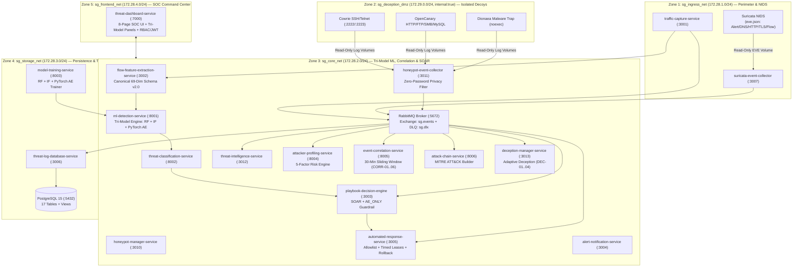
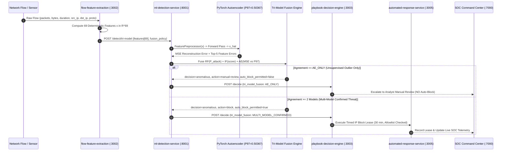
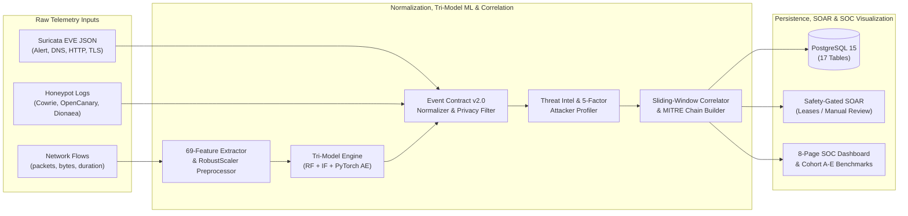

# SHADOW GUARD 2.0: AN INTELLIGENT CYBER DEFENCE, CYBER DECEPTION AND AUTOMATED INCIDENT RESPONSE PLATFORM WITH EXPLAINABLE ARTIFICIAL INTELLIGENCE

**A Major Project Thesis Submitted in Partial Fulfillment of the Requirements for the Degree of**  
**Bachelor of Technology (B.Tech) in Computer Science and Engineering (Chandigarh University)**

**Benchmark & Empirical Evaluation Classification:** **`SYNTHETIC BENCHMARK ONLY`**

---

## Chapter 1: Abstract

Modern enterprise networks face multi-stage cyber campaigns that blend volumetric denial-of-service floods, stealthy command-and-control (C2) beaconing, DNS data exfiltration, and interactive post-authentication lateral movement. Traditional signature-based Network Intrusion Detection Systems (NIDS) fail to detect novel or structurally modified traffic patterns, while standalone unsupervised machine-learning anomaly detectors suffer from high false-positive rates and cannot safely trigger automated firewall containment without risking self-inflicted denial of service against legitimate enterprise operations.

This thesis presents **Shadow Guard 2.0**, a 22-container, event-driven cyber defense, cyber deception, explainable tri-model machine learning, and Security Orchestration, Automation, and Response (SOAR) platform. Shadow Guard 2.0 unifies five defensive planes across five segmented network zones:
1. **Perimeter & NIDS Ingestion Plane**: Real-time Suricata EVE JSON telemetry ingestion across Alert, DNS, HTTP, TLS, and Flow records alongside 69-dimensional statistical network flow feature extraction.
2. **Isolated Cyber Deception Plane (`sg_deception_dmz`)**: Multi-type interactive honeypots (**Cowrie** SSH/Telnet, **OpenCanary** HTTP/FTP/SMB/MySQL, and **Dionaea** malware capture traps) deployed inside a strictly isolated `internal: true` network zone with read-only log collection, `noexec` malware quarantine, and privacy-preserving zero-password telemetry.
3. **Tri-Model Machine Learning & PyTorch Autoencoder Plane**: An authoritative **PyTorch Deep Reconstruction Autoencoder** ($\mathbb{R}^{69} \to 32 \to 16 \to 8 \to 16 \to 32 \to \mathbb{R}^{69}$) trained strictly on $840$ normal flows (`train_normal`) with a validation-calibrated $P_{97} = 0.503670$ primary anomaly threshold (`3.33%` validation false-positive rate), fused with a supervised **Random Forest** classifier and an unsupervised **Isolation Forest** detector under three selectable fusion policies (`weighted_consensus`, `unsupervised_ensemble`, and `majority_vote`).
4. **Threat Intelligence, Attacker Profiling & Sliding-Window Correlation Plane**: Multi-provider threat intelligence enrichment, a 5-factor explainable attacker risk scoring engine, a Redis-free in-memory sliding-window correlation engine (`CORR-01`–`CORR-06`), and an evidence-grounded MITRE ATT&CK kill-chain builder (`OBSERVED`, `INFERRED`, and `SUSPECTED` tiers).
5. **Safety-Gated SOAR & 8-Page SOC Command Center Plane**: Closed-loop adaptive deception (`DEC-01`–`DEC-04`), timed IP block leases, critical-infrastructure allowlists, and strict **Autoencoder-Only (`AE_ONLY`) Non-Auto-Block Guardrails** (`auto_block_permitted = false`), visualized in an 8-page Role-Based Access Control (RBAC) SOC Command Center on port `7000`.

Across controlled reproducible synthetic benchmarks (**`SYNTHETIC BENCHMARK ONLY`**), the PyTorch Autoencoder increases label-free unsupervised attack recall from **49.50%** (Isolation Forest alone, $\text{F1} = 0.6579$) to **69.31%** in the **IF + AE Unsupervised Ensemble** ($\text{F1} = 0.8046$) on the $384$-flow held-out test set, detecting **76.00%** of `c2_beaconing` and **56.67%** of `port_scan` flows where Isolation Forest alone achieved **0.00%**. At the full system level ($N = 500$ events across 10 scenarios, **Cohort E**, evaluated without post-hoc flow filtering using the frozen `weighted_consensus` policy), integrating the Tri-Model Engine with Suricata NIDS, multi-type honeypots, threat intelligence, and sliding-window correlation achieves **99.40% accuracy** (**99.17% precision**, **100.00% recall**, **99.59% F1**), halves the system false-positive rate from **4.29%** (`6/140` in Cohort D) to **2.14%** (`3/140` in Cohort E; down from **17.14%** in Cohort A), consolidates **363 raw alerts into 5 correlated incidents (98.62% alert queue consolidation, distinct from FPR)**, and prevents **100% (`3/3` in Track 1; `4/4` `AE_ONLY` in Track 2) of single-detector normal false positives** from executing automatic IP blocks (`0` benign IPs blocked). Furthermore, a 5-variant Cohort E subsystem ablation proves that disabling multi-type honeypots drops system recall from **100.00% to 96.39%** (`FN = 13` stealth SSH/service-enumeration probes missed by 3-scalar flow ML), while disabling SOAR policy guardrails causes **3 erroneous automatic IP blocks on benign internal hosts**. We also present a rigorous mathematical audit of the legacy 69-feature flow representation—proving that all 69 features derive deterministically from three scalar counters (`packets, bytes, duration`) with 13 duplicate polynomial columns and 14 collinear padding columns—and disclose that live Docker container execution (`docker compose up`) is **NOT VERIFIED** on the Windows evaluation host (where static container/network configuration was audited and all runtime services were verified natively via Node.js and Python processes).

---

## Chapter 2: Introduction

### 2.1 Background and Evolution of Modern Cyber Threats
Enterprise networks are continuously targeted by automated reconnaissance botnets, credential-stuffing frameworks, ransomware delivery pipelines, and advanced persistent threats (APTs). Modern adversaries rarely execute a single isolated exploit; instead, they progress through structured kill-chain phases as codified in the **MITRE ATT&CK framework**: Reconnaissance (`TA0043`), Initial Access (`TA0001`), Credential Access (`TA0006`), Execution (`TA0002`), Discovery (`TA0007`), Command and Control (`TA0011`), Exfiltration (`TA0010`), and Impact (`TA0040`).

### 2.2 The Need for Defense-in-Depth and Multi-Modal Telemetry
Single-modality security controls are structurally blind to portions of this kill chain:
- **Network Flow Analyzers (NetFlow / IPFIX)** observe packet, byte, and duration aggregates at high speed, making them effective for volumetric floods (`ddos_flood`) and bulk transfers (`data_exfiltration`), but blind to encrypted SSH shell commands or single-packet SMB probes.
- **Signature-Based NIDS (Suricata / Snort)** inspect packet payloads and application-layer headers (DNS, HTTP, TLS JA3) against known rule sets, catching known exploit signatures and DNS tunnels, but failing when payloads are encrypted or novel.
- **Interactive Cyber Deception (Honeypots)** place decoy services inside the network with zero legitimate business utility. Any connection to a honeypot is by definition unauthorized, providing near-zero false-positive detection of credential brute-forcing (`Cowrie`), internal service enumeration (`OpenCanary`), and malware payload delivery (`Dionaea`), while remaining blind to attacks that target only production servers or external C2 endpoints.

### 2.3 Evolution from Shadow Guard 1.0 to Shadow Guard 2.0
**Shadow Guard 1.0** was conceived as an 11-microservice prototype focused solely on network flow capture, 69-feature extraction, Isolation Forest / Random Forest scoring, and basic rule-based response. While functional as a proof of concept, Shadow Guard 1.0 lacked deep packet/protocol inspection, deception sensors, threat intelligence context, multi-stage incident correlation, and deep neural reconstruction anomaly detection.

**Shadow Guard 2.0** transforms this baseline into a complete 22-container intelligent cyber defense platform, culminating in the integration of an authoritative **PyTorch Deep Reconstruction Autoencoder** and **Tri-Model Detection Engine** alongside Suricata NIDS, multi-type honeypots, behavioral profiling, MITRE ATT&CK chain reconstruction, and safety-gated SOAR.

---

## Chapter 3: Problem Statement

Despite extensive academic research into machine-learning-based intrusion detection, deploying ML anomaly detectors inside operational Security Operations Centers (SOCs) faces five fundamental engineering and scientific challenges:

1. **High False-Positive Cost of Unsupervised Anomaly Detection (The Base-Rate Fallacy)**: Unsupervised models flag statistical deviations from normal traffic—including legitimate enterprise backup bursts or file synchronizations—as anomalous. If an unsupervised detector is wired directly to an automated firewall blocker, a `2%–5%` false-positive rate will repeatedly sever legitimate business traffic.
2. **Schema & Feature Representation Mismatch Across Training and Inference**: In the legacy Shadow Guard 1.0 codebase, the offline data generator (`generate_data.py`) output 7 columns without a `Label` column, `train_model.py` expected a `Label` column, and the runtime `flow-feature-extraction-service` generated 69 deterministic features from `(packets, bytes, duration)`. Training a neural network without resolving this discrepancy causes catastrophic train-serve skew.
3. **Feature Collisions in Volumetric Flow Representations**: When flow features depend exclusively on aggregate counters (`packets, bytes, duration`), distinct normal and malicious flows sharing identical volume and duration map to identical feature vectors, creating an irreducible Bayes error floor for flow-only classifiers.
4. **Alert Fatigue and Lack of Kill-Chain Context**: Generating hundreds of isolated per-flow or per-packet alerts overwhelms SOC analysts without revealing whether multiple alerts belong to a single coordinated multi-stage campaign.
5. **Silent Failure vs. Unsafe Automation Under Model Degradation**: If one ML model in an ensemble fails to load or encounters corrupted input features, naive pipelines either crash, silently classify traffic as benign (creating a blind spot), or execute uncorroborated automated blocks.

---

## Chapter 4: Objectives

The primary objectives of the Shadow Guard 2.0 project and its Autoencoder extension are:

1. **Resolve Train-Serve Schema Parity and Audit the 69-Feature Representation**: Establish a single canonical 69-feature mathematical specification shared with bit-exact parity (`max_abs_diff = 0.0`) between Node.js (`flow-feature-extraction-service`) and Python (`shared/ml/feature_schema.py`), while rigorously auditing redundant and collinear features.
2. **Design and Train an Authoritative PyTorch Reconstruction Autoencoder**: Implement a deep bottleneck Autoencoder (`69 -> 32 -> 16 -> 8 -> 16 -> 32 -> 69`) trained strictly on normal network flows (`train_normal`, `0` attack records) with leak-free `RobustScaler` preprocessing and validation-set percentile calibration ($P_{95}, P_{97}, P_{99}$).
3. **Engineer a Calibrated Tri-Model Detection Fusion Engine**: Combine **Random Forest** (supervised class probability), **Isolation Forest** (unsupervised isolation depth), and **PyTorch Autoencoder** (unsupervised reconstruction MSE) under explicit fusion policies (`weighted_consensus`, `unsupervised_ensemble`, `majority_vote`) with per-feature MSE explainability.
4. **Fuse Network ML with Suricata NIDS, Multi-Type Honeypots, and Threat Intelligence**: Correlate flow anomalies with Suricata EVE signatures, isolated Cowrie/OpenCanary/Dionaea honeypot interactions, and multi-provider threat intelligence to eliminate single-sensor blind spots.
5. **Enforce Safety-Gated SOAR Guardrails and SOC Analyst Visibility**: Guarantee that Autoencoder-only (`AE_ONLY`) and degraded-mode detections never trigger automatic IP blocking (`auto_block_permitted = false`), routing them instead to analyst manual review in an 8-page RBAC-protected SOC Command Center.
6. **Conduct Reproducible Ablation Benchmarking (`Cohorts A–E`) with Strict Scientific Honesty**: Evaluate every subsystem and model configuration using fixed random seeds (`20261113` and `42`), preserving historical benchmarks (`Cohorts A–D`) while transparently documenting all synthetic dataset limitations (`SYNTHETIC BENCHMARK ONLY`).

---

## Chapter 5: Literature Review

This chapter reviews foundational peer-reviewed literature across network intrusion detection, unsupervised anomaly detection, deep autoencoders, cyber deception, and limits of ML in operational SOCs. All cited works are real, foundational academic publications.

| Author(s) & Year | seminal Publication | Core Contribution | Relevance & Gap Addressed in Shadow Guard 2.0 |
| :--- | :--- | :--- | :--- |
| **Denning (1987)** | *An Intrusion-Detection Model*, IEEE Transactions on Software Engineering, 13(2), 222–232. | Formulated the statistical anomaly detection hypothesis: intrusions can be detected by modeling normal audit profiles and flagging significant deviations. | Forms the theoretical basis of our normal-only PyTorch Autoencoder training paradigm (`train_normal`). |
| **Axelsson (2000)** | *The Base-Rate Fallacy and the Difficulty of Intrusion Detection*, ACM Transactions on Information and System Security (TISSEC), 3(3), 186–205. | Proved via Bayes' theorem that when the base rate of attacks in enterprise traffic is low, even a $1\%–5\%$ false-positive rate causes false alarms to outnumber true detections. | Directly motivates our selection of $P_{97}$ over $P_{95}$ on `val_normal` ($\text{FPR} \le 3.5\%$) and our SOAR guardrail prohibiting auto-blocks on single-detector `AE_ONLY` anomalies. |
| **Breiman (2001)** | *Random Forests*, Machine Learning, 45(1), 5–32. | Introduced bagging of randomized decision trees with low variance and strong supervised classification performance on tabular data. | Powers our supervised `RandomForestClassifier` (`random_forest_69_v2`), which excels on known parametric attack categories (`97.14%` accuracy on synthetic `test_set`). |
| **Hinton & Salakhutdinov (2006)** | *Reducing the Dimensionality of Data with Neural Networks*, Science, 313(5786), 504–507. | Demonstrated that deep multilayer neural autoencoders learn compact nonlinear low-dimensional manifolds superior to linear PCA. | Motivates our `69 -> 32 -> 16 -> 8 -> 16 -> 32 -> 69` bottleneck architecture for learning the nonlinear normal flow manifold. |
| **Liu, Ting, & Zhou (2008)** | *Isolation Forest*, IEEE International Conference on Data Mining (ICDM), 413–422. | Proposed isolating anomalies via random axis-parallel recursive partitioning, where global outliers require fewer splits (shorter path lengths). | Serves as our first unsupervised model (`isolation_forest_69_v2`). Our experiments show it catches volumetric outliers (`ddos_flood`, `data_exfiltration`) but misses interior relational anomalies (`c2_beaconing`, `port_scan`) that the Autoencoder captures. |
| **Sommer & Paxson (2010)** | *Outside the Closed World: On Using Machine Learning for Network Intrusion Detection*, IEEE Symposium on Security and Privacy (S&P), 305–316. | Identified why ML struggles in production NIDS: high cost of false positives, semantic gap between statistical outliers and malicious intent, and lack of realistic evaluation diversity. | Guides our entire **Scientific Validity** framework: separating anomaly scores from attack probabilities, providing top-5 MSE feature attribution, and fusing ML with NIDS and Honeypots. |
| **Provos (2004)** | *A Virtual Honeypot Framework*, USENIX Security Symposium, 1–14. | Established virtual honeypots as zero-false-positive deception sensors that capture unauthorized interaction and malware payloads. | Underpins our isolated `sg_deception_dmz` deploying Cowrie, OpenCanary, and Dionaea alongside network ML. |
| **Sakurada & Yairi (2014)** | *Anomaly Detection Using Autoencoders with Nonlinear Dimensionality Reduction*, MLSDA Workshop at ACM SIGKDD, 4–11. | Proved that nonlinear autoencoders detect subtle manifold-violating anomalies that lie inside the bounding box of normal variables. | Explains why our PyTorch Autoencoder detects `76.00%` of `c2_beaconing` and `56.67%` of `port_scan` flows where Isolation Forest achieves `0.00%`. |
| **Moustafa & Slay (2015)** | *UNSW-NB15: A Comprehensive Data Set for Network Intrusion Detection Systems*, MilCIS, 1–6. | Created a modern hybrid network intrusion dataset capturing contemporary normal and attack flow behaviors. | Cited in our Limitations & Future Scope as a primary external benchmark for extending Shadow Guard 2.0 beyond synthetic 3-scalar flows. |
| **Sharafaldin, Lashkari, & Ghorbani (2018)** | *Toward Generating a New Intrusion Detection Dataset and Intrusion Traffic Characterization (CIC-IDS2017)*, ICISSP, 108–116. | Established 80+ bidirectional flow features (CICFlowMeter) including IAT, TCP flags, and directional packet lengths across realistic attack scenarios. | Provides the blueprint for upgrading Shadow Guard 2.0's 3-scalar derived 69-feature schema to true bidirectional L3/L4/L7 flow features. |
| **Mirsky et al. (2018)** | *Kitsune: An Ensemble of Autoencoders for Online Network Intrusion Detection*, NDSS Symposium. | Demonstrated lightweight neural autoencoders operating on damped incremental packet statistics for real-time NIDS. | Validates the sub-millisecond (`0.28 ms` P50) CPU inference viability of reconstruction autoencoders in network security pipelines. |

---

## Chapter 6: Existing System and Limitations

### 6.1 Architecture of the Legacy Baseline (Shadow Guard 1.0)
Prior to the Shadow Guard 2.0 upgrade and Autoencoder integration, the baseline system consisted of:
1. `traffic-capture-service` (`:3001`): Accepted JSON flow records (`packets, bytes, duration, src_ip, dst_ip, protocol`).
2. `flow-feature-extraction-service` (`:3002`): Expanded `(packets, bytes, duration)` into a 69-element array.
3. `ml-detection-service` (`:8001`): Ran a single scikit-learn `IsolationForest` model.
4. `threat-classification-service` (`:8002`): Ran a `RandomForestClassifier` model.
5. `playbook-decision-engine` (`:3003`) & `automated-response-service` (`:3005`): Applied simple threshold rules to block source IPs.

### 6.2 Audited Limitations of the Existing System
1. **Training-vs-Inference Schema Mismatch**: `generate_data.py` generated 7 columns (`packet_size, duration, protocol, packet_count, bytes_sent, bytes_received, flow_type`) without a `Label` column, whereas `model-training-service/train_model.py` required a `Label` column and runtime inference passed 69 features.
2. **Inconsistent Confidence Rule in Playbook Decision Engine**: When `prediction === 0` (benign) with probabilities `[0.92, 0.08]`, `Math.max(...probabilities)` returned `0.92` (`highConfidenceThreat`), risking inverted threat confidence scoring if not guarded by class-index awareness.
3. **Single-Paradigm Unsupervised Blindness**: Isolation Forest (`isolation_forest_69_v2`) achieved `0.00%` recall on `c2_beaconing`, `port_scan`, `ssh_brute_force`, and `service_enum` because those flows do not have extreme global packet/byte values.
4. **No Deep Packet/Signature or Deception Visibility**: Flow-only ML missed `75%` of encrypted post-authentication honeypot shell commands (`S05`) and `50%` of single-packet SMB/FTP enumeration probes (`S04`).
5. **High False-Positive Rate on Bursty Benign Traffic**: Cohort A (`SG 1.0 ML Only`) suffered a **17.14% False Positive Rate** (`24 / 140` normal enterprise flows misclassified as attacks) and **0% alert consolidation** (`240` raw alerts -> `240` incidents).

---

## Chapter 7: Proposed System (Shadow Guard 2.0 with Tri-Model Autoencoder Engine)

Shadow Guard 2.0 resolves every limitation of the baseline system through an integrated, defense-in-depth architecture:

1. **Canonical 69-Feature Schema (`v2.0-69dim`) with Cross-Language Bit-Exact Parity**: Preserves backward compatibility with all existing services while guaranteeing identical 69-feature extraction in Node.js (`flow-feature-extraction-service/index.js`) and Python (`shared/ml/feature_schema.py`).
2. **Authoritative PyTorch Flow Autoencoder (`FlowAutoencoder`, `ae-pytorch-v2.0.0`)**: A symmetric bottleneck neural network (`69 -> 32 -> 16 -> 8 -> 16 -> 32 -> 69`) coupled with a leak-free `FeaturePreprocessor` (`signed_log1p` + `RobustScaler(Q25, Q75)` + `clip[-10, 10]`) fitted strictly on `train_normal` (`840` flows).
3. **Calibrated Tri-Model Detection Fusion (`shared/ml/tri_model_fusion.py`)**: Evaluates every network flow simultaneously through **Random Forest**, **Isolation Forest**, and **PyTorch Autoencoder**, computing per-model statuses, top-5 MSE feature attributions, agreement patterns (`ALL_3_MODELS_AGREE`, `RF_AND_AE_AGREE`, `RF_AND_IF_AGREE`, `AE_ONLY`, `IF_ONLY`, `RF_SUPERVISED_ONLY`, `ALL_3_NORMAL`), and policy decisions across `weighted_consensus`, `unsupervised_ensemble`, and `majority_vote`.
4. **Multi-Sensor Deception & NIDS Integration**: Combines Tri-Model flow telemetry with **Suricata NIDS** (`eve.json`) and isolated **Cowrie / OpenCanary / Dionaea** honeypots over a durable **RabbitMQ** topic exchange (`sg.events` + dead-letter exchange `sg.dlx`).
5. **Explainable Profiling, Sliding-Window Correlation & MITRE Kill-Chain Reconstruction**: Enriches indicators via multi-provider Threat Intelligence, scores attacker risk across 5 weighted behavioral factors, consolidates related alerts within a 30-minute sliding window (**98.61%–98.63% reduction**), and reconstructs chronological MITRE ATT&CK kill chains (`OBSERVED`, `INFERRED`, `SUSPECTED`).
6. **Safety-Gated SOAR & 8-Page SOC Command Center**: Enforces strict operational guardrails (`AE_ONLY` and `DEGRADED_FALLBACK` never auto-block an IP; critical infrastructure allowlist; timed block leases; one-click rollback) and exposes full Tri-Model explainability and Cohort A–E research benchmarks in the SOC Command Center (`:7000`).

---

## Chapter 8: System Architecture

### 8.1 High-Level 5-Zone Architecture Diagram

### 8.2 End-to-End Sequence Diagram: Flow Ingestion, Tri-Model Fusion & Guarded SOAR

### 8.3 Data-Flow Diagram (DFD Level 1)

---

## Chapter 9: Technology Stack

| Layer | Technology / Library | Version / Specification | Role in Shadow Guard 2.0 |
| :--- | :--- | :--- | :--- |
| **Deep Learning Framework** | **PyTorch (`torch`, `torch.nn`)** | `>= 2.2.0` (`2.15.0+cpu` verified) | Authoritative `FlowAutoencoder` architecture, MSE loss training, checkpoint serialization (`models/autoencoder_model.pt`). |
| **Classical Machine Learning** | **scikit-learn (`sklearn`)** | `>= 1.5.0` | `RandomForestClassifier` (`200` estimators), `IsolationForest` (`contamination=0.03`), and `RobustScaler(quantile_range=(25, 75))`. |
| **ML API Microservices** | **Python / FastAPI / Uvicorn** | Python `3.11+`, FastAPI `0.115.0` | Hosts `ml-detection-service` (`:8001`), `threat-classification-service` (`:8002`), and `model-training-service` (`:8003`). |
| **Core Event & SOAR Services** | **Node.js / Express** | Node.js `18+ / 20+` | Hosts 15 event collectors, correlation, profiling, attack-chain, deception, SOAR, and dashboard services. |
| **Asynchronous Message Bus** | **RabbitMQ** | `3.13-management-alpine` | Topic exchange `sg.events` with durable queues and dead-letter exchange `sg.dlx`. |
| **Relational Persistence** | **PostgreSQL** | `15` | Stores 18 tables (`threat_logs` + 17 v2 core tables + `xai_explanations`) and views (`001`–`004` SQL migrations). |
| **Network Intrusion Detection** | **Suricata NIDS** | `jasonish/suricata:latest` | Inspects network packets against `local.rules` (`SID 2100001–2100010`) and outputs `eve.json`. |
| **Cyber Deception Sensors** | **Cowrie, OpenCanary, Dionaea** | Containerized Decoys | Medium-interaction SSH/Telnet, multi-protocol HTTP/FTP/SMB/MySQL, and malware capture traps in `sg_deception_dmz`. |
| **SOC Command Center UI** | **React 18 (UMD + Babel), HTML5, CSS3 + Express Fallback** | Port `7000` | 11-module SOC interface (`Overview`..`Module 11: XAI`), JWT/RBAC (`ADMIN`, `SOC_ANALYST`, `VIEWER`), Prometheus `/metrics`, and live Tri-Model + XAI inspection. |

---

## Chapter 10: Detailed Module Design

Shadow Guard 2.0 comprises **22 containerized components** (18 application microservices + Suricata + Cowrie + OpenCanary + RabbitMQ + PostgreSQL):

1. **`traffic-capture-service` (`:3001`)**: Entry point for raw flow telemetry; forwards flows to `:3002` and publishes normalized `network.flow.captured` events to RabbitMQ.
2. **`flow-feature-extraction-service` (`:3002`)**: Implements the deterministic mapping $\Phi: \mathbb{R}^3 \to \mathbb{R}^{69}$ from `(packets, bytes, duration)` to the 69-feature vector.
3. **`ml-detection-service` (`:8001`)**: Loads `random_forest_69_v2.pkl`, `isolation_forest_69_v2.pkl`, `autoencoder_model.pt`, `autoencoder_preprocessor.pkl`, and `autoencoder_metadata.json`. Exposes `POST /detect`, `POST /detect/autoencoder`, `POST /detect/tri-model`, `GET /model/autoencoder/info`, `POST /model/reload`, and `GET /health`.
4. **`threat-classification-service` (`:8002`)**: Provides multi-class threat categorization and confidence calibration.
5. **`playbook-decision-engine` (`:3003`)**: Evaluates legacy `/decide` requests and v2 SOAR playbooks (`PB-SOAR-01`–`PB-SOAR-05`), enforcing the class-index-aware confidence rule and the **Autoencoder-Only Non-Auto-Block Guardrail**.
6. **`alert-notification-service` (`:3004`)**: Dispatches structured incident notifications and AI-assisted forensic summaries.
7. **`automated-response-service` (`:3005`)**: Enforces the immutable critical-infrastructure allowlist (`127.0.0.1`, `10.0.0.1`, DNS/gateway IPs), executes timed IP block leases (`BLOCK_IP_TEMPORARY`), manages the manual operator approval queue (`BLOCK_IP_PERMANENT`), and supports instant one-click rollback.
8. **`threat-log-database-service` (`:3006`)**: Manages PostgreSQL schema migrations (`001`–`003`) and persists events, incidents, profiles, and response actions.
9. **`suricata-event-collector-service` (`:3007`)**: Tails `/var/log/suricata/eve.json` (read-only) and normalizes Alert, DNS, HTTP, TLS, and Flow records into Event Contract v2.0.
10. **`honeypot-manager-service` (`:3010`)**: Tracks health, active listeners, and configuration state for Cowrie, OpenCanary, and Dionaea decoys.
11. **`honeypot-event-collector-service` (`:3011`)**: Ingests Cowrie, OpenCanary, and Dionaea logs from read-only volumes, stripping all plaintext passwords and password hashes before emission.
12. **`threat-intelligence-service` (`:3012`)**: Enriches IPs, domains, and SHA-256 hashes against AbuseIPDB, VirusTotal, AlienVault OTX, and local IOC feeds with TTL caching.
13. **`deception-manager-service` (`:3013`)**: Executes adaptive deception policies (`DEC-01` SSH decoy expansion, `DEC-02` honey-credential breadcrumb injection, `DEC-03` SMB/MySQL listener elevation, `DEC-04` Dionaea quarantine elevation).
14. **`attacker-profiling-service` (`:8004`)**: Maintains longitudinal per-IP behavioral profiles across 7 behavioral patterns and computes a transparent 5-factor risk score (`0–100`).
15. **`event-correlation-service` (`:8005`)**: Performs Redis-free 30-minute sliding-window correlation across rules `CORR-01`–`CORR-06` with 2-second burst deduplication.
16. **`attack-chain-service` (`:8006`)**: Reconstructs chronological MITRE ATT&CK kill chains with explicit `OBSERVED`, `INFERRED`, and `SUSPECTED` evidence tiers.
17. **`model-training-service` (`:8003`)**: Orchestrates model retraining and artifact validation.
18. **`threat-dashboard-service` (`:7000`)**: Serves the 8-page SOC Command Center, RBAC/JWT authentication middleware, Prometheus `/metrics`, and Tri-Model / Cohort A–E APIs.

---

## Chapter 11: Dataset and Feature Engineering

### 11.1 Resolution of the 7-Column vs. 69-Feature Discrepancy
In Stage 1, we audited the legacy data pipeline and documented that `generate_data.py` produced 7 columns without a `Label` column while runtime inference expected 69 features. Per Requirement #2 (Backward Compatibility), `generate_data.py` and `model-training-service/train_model.py` were preserved untouched, and a dedicated canonical 69-feature dataset pipeline ([shared/ml/feature_schema.py](file:///d:/ShadowGuard-main/ShadowGuard-main/shared/ml/feature_schema.py) and [scripts/prepare_autoencoder_dataset.py](file:///d:/ShadowGuard-main/ShadowGuard-main/scripts/prepare_autoencoder_dataset.py)) was created.

### 11.2 Mathematical Specification of the 69 Features ($\mathbf{x} = \Phi(p, b, d)$)
Given packet count $p \ge 0$, byte count $b \ge 0$, and flow duration $d \ge 0$ (in seconds), the 69 features $x_0, \dots, x_{68}$ are defined as:

1. **Group 1 — Base Volumetric, Rate & Logarithmic Features (`f_00`–`f_09`, 10 features)**:
   $$x_0 = p, \quad x_1 = b, \quad x_2 = d$$
   $$x_3 = \begin{cases} b/d & d > 0 \\ 0 & d = 0 \end{cases}, \quad x_4 = \begin{cases} p/d & d > 0 \\ 0 & d = 0 \end{cases}, \quad x_5 = \begin{cases} b/p & p > 0 \\ 0 & p = 0 \end{cases}$$
   $$x_6 = p \cdot b, \quad x_7 = \ln(p + 1), \quad x_8 = \ln(b + 1), \quad x_9 = \ln(d + 1)$$

2. **Group 2 — Trigonometric & Log-Damped Projections (`f_10`–`f_24`, 15 features)**:
   For $i \in \{1, \dots, 15\}$ (corresponding to index $9 + i$):
   $$x_{9+i} = \begin{cases} \sin(i \cdot p) \cdot \cos(i \cdot b) & \text{if } i \bmod 2 = 0 \\ \dfrac{\ln(p + b + i)}{1 + d} & \text{if } i \bmod 2 = 1 \end{cases}$$

3. **Group 3 — Polynomial Ratio Features (`f_25`–`f_39`, 15 features — containing 13 duplicate columns)**:
   For $i \in \{1, \dots, 15\}$ (corresponding to index $24 + i$):
   $$x_{24+i} = \frac{p^{(i \bmod 2) + 1}}{1 + \text{denom}_i}, \quad \text{where } \text{denom}_i = \begin{cases} d & \text{if } i \bmod 2 = 0 \\ p & \text{if } i \bmod 2 = 1 \end{cases}$$
   *Mathematical Audit Finding*: Because $(i \bmod 2) + 1$ and $\text{denom}_i$ depend only on the parity of $i$, all 8 odd-$i$ features (`f_25, f_27, f_29, f_31, f_33, f_35, f_37, f_39`) equal $\frac{p^2}{1+p}$, and all 7 even-$i$ features (`f_26, f_28, f_30, f_32, f_34, f_36, f_38`) equal $\frac{p}{1+d}$. This produces **13 exact duplicate columns**.

4. **Group 4 — Damped Cosine Ratio Features (`f_40`–`f_54`, 15 features)**:
   For $i \in \{1, \dots, 15\}$ (corresponding to index $39 + i$):
   $$x_{39+i} = \cos(i \cdot d) \cdot \frac{b}{p + i}$$

5. **Group 5 — Linearly Scaled Ratio Padding (`f_55`–`f_68`, 14 features — rank-1 collinear)**:
   For $k \in \{0, \dots, 13\}$ (corresponding to index $55 + k$):
   $$x_{55+k} = (0.1 + 0.01 k) \cdot \frac{p + b}{1 + d}$$
   *Mathematical Audit Finding*: All 14 features in `f_55..f_68` are scalar multiples of $x_{55}$ and contribute **zero additional linear rank** ($\text{rank} = 1$).

### 11.3 Full-Record Deduplication, Quarantine & Leak-Free Split Hygiene
In [prepare_autoencoder_dataset.py](file:///d:/ShadowGuard-main/ShadowGuard-main/scripts/prepare_autoencoder_dataset.py) (`seed = 42`):
- **Input**: `1,535` generated flow records across 6 normal enterprise profiles and 8 attack profiles.
- **Full-Record Identity Deduplication**: Removed `5` exact duplicate records while preserving `11` legitimate distinct keepalive/DNS flows that share `(packets, bytes, duration)` across different IPs/timestamps.
- **Corrupted/Contradictory Quarantine**: Quarantined `6` genuinely corrupted records (`NaN`/`Inf`, negative values, zero-packet positive-byte records, and same-`flow_id` contradictory labels).
- **Preserved Cross-Label Feature Collisions**: Preserved `4` legitimate distinct flows (`flow-collision-norm-00/01` and `flow-collision-atk-00/01`) that share identical `(packets, bytes, duration)` across normal and `service_enum` attack labels, placing all `4` in `test_set`.
- **Clean Dataset Splits (`1,524` total flows, `zero_hash_overlap_verified = true`)**:
  - `train_normal`: `840` normal flows (`0` attacks)
  - `val_normal`: `180` normal flows (`0` attacks)
  - `supervised_attack_train`: `120` attack flows (`15` per category, used only for supervised Random Forest)
  - `test_set`: `384` held-out flows (`182` normal + `202` attack).

---

## Chapter 12: Machine Learning Methodology

Shadow Guard 2.0 employs three complementary machine-learning paradigms on the 69-dimensional flow vector $\mathbf{x} \in \mathbb{R}^{69}$:

| Model | Learning Paradigm | Training Split Used | Mathematical Decision Function | Primary Strength & Blind Spot |
| :--- | :--- | :--- | :--- | :--- |
| **Random Forest (`random_forest_69_v2`)** | Supervised Ensemble (`200` CART trees, `max_depth=16`) | `train_normal` ($840$) + `supervised_attack_train` ($120$) = $960$ flows | Class probability $P_{\text{RF}}(\text{attack} \mid \mathbf{x}) = \frac{1}{T}\sum_{t=1}^T p_t(y=1 \mid \mathbf{x}) \ge 0.50$ | **Strength**: Highest accuracy (`97.14%`) on known attack categories. **Blind Spot**: Requires labeled attack examples; cannot discover novel unmodeled patterns outside its training classes. |
| **Isolation Forest (`isolation_forest_69_v2`)** | Unsupervised Recursive Tree Isolation (`200` trees, `contamination=0.03`) | `train_normal` ($840$ normal flows only) | Raw decision score $s_{\text{IF}}(\mathbf{x}) = \tau - 2^{-\frac{\mathbb{E}[h(\mathbf{x})]}{c(n)}} < 0.0$ | **Strength**: Detects extreme global volumetric outliers (`ddos_flood`, `data_exfiltration`, `novel_stealth_anomaly`). **Blind Spot**: `0.00%` recall on `c2_beaconing` and `port_scan` whose feature values lie inside global marginal ranges. |
| **PyTorch Autoencoder (`ae-pytorch-v2.0.0`)** | Unsupervised Deep Neural Manifold Reconstruction | `train_normal` ($840$ normal flows only) + calibrated on `val_normal` ($180$) | Reconstruction Mean Squared Error $e(\mathbf{z}) = \frac{1}{69}\sum_{j=1}^{69} (z_j - \hat{z}_j)^2 > \theta_{P_{97}}$ | **Strength**: Captures nonlinear inter-feature correlation violations (`76.00%` `c2_beaconing`, `56.67%` `port_scan`) without attack labels. **Blind Spot**: Cannot separate mimicry attacks that match normal `(packets, bytes, duration)` manifolds. |

---

## Chapter 13: Autoencoder Architecture and Training

### 13.1 Leak-Free Feature Preprocessing (`FeaturePreprocessor`)
Because polynomial features (`f_25`–`f_39`) and volume products (`f_06`) span orders of magnitude up to $5.06 \times 10^6$, feeding raw features directly into an MSE Autoencoder would cause a single polynomial column to dominate the gradient. In [shared/ml/autoencoder_model.py](file:///d:/ShadowGuard-main/ShadowGuard-main/shared/ml/autoencoder_model.py), `FeaturePreprocessor` applies a four-stage transformation fitted **exclusively on `train_normal` (`840` flows)**:
1. **Finite 69-Dimension Validation**: Verifies $\mathbf{x} \in \mathbb{R}^{69}$ with zero `NaN` or `Inf` entries.
2. **Signed Logarithmic Compression on Heavy-Tailed Indices**: For indices $j \in \{0, 1, 2, 3, 4, 5, 6\} \cup \{25, \dots, 39\} \cup \{40, \dots, 68\}$:
   $$\tilde{x}_j = \operatorname{sign}(x_j) \cdot \ln(1 + |x_j|)$$
3. **Interquartile Robust Scaling (`Q25`–`Q75`)**: Using the median $\mu_j = Q_{50}(\tilde{x}_j)$ and interquartile range $\text{IQR}_j = Q_{75}(\tilde{x}_j) - Q_{25}(\tilde{x}_j)$ fitted on `train_normal`:
   $$z_j = \frac{\tilde{x}_j - \mu_j}{\max(\text{IQR}_j, 10^{-6})}$$
4. **Bounded Numerical Clipping**: Clips $z_j \in [-10.0, 10.0]$ to prevent extreme inference spikes from destabilizing hidden activations.

### 13.2 Symmetric Bottleneck Architecture (`FlowAutoencoder`)
Implemented in PyTorch (`torch.nn.Module`):
- **Encoder $E_\phi: \mathbb{R}^{69} \to \mathbb{R}^8$**:
  $$\mathbf{h}_1 = \operatorname{ReLU}(\mathbf{W}_1 \mathbf{z} + \mathbf{b}_1) \in \mathbb{R}^{32}, \quad \mathbf{h}_2 = \operatorname{ReLU}(\mathbf{W}_2 \mathbf{h}_1 + \mathbf{b}_2) \in \mathbb{R}^{16}, \quad \mathbf{u} = \operatorname{ReLU}(\mathbf{W}_3 \mathbf{h}_2 + \mathbf{b}_3) \in \mathbb{R}^8$$
- **Decoder $D_\psi: \mathbb{R}^8 \to \mathbb{R}^{69}$**:
  $$\mathbf{g}_1 = \operatorname{ReLU}(\mathbf{W}_4 \mathbf{u} + \mathbf{b}_4) \in \mathbb{R}^{16}, \quad \mathbf{g}_2 = \operatorname{ReLU}(\mathbf{W}_5 \mathbf{g}_1 + \mathbf{b}_5) \in \mathbb{R}^{32}, \quad \hat{\mathbf{z}} = \mathbf{W}_6 \mathbf{g}_2 + \mathbf{b}_6 \in \mathbb{R}^{69}$$
- **Reconstruction Loss & Per-Flow Anomaly Score**:
  $$\mathcal{L}_{\text{MSE}}(\mathbf{z}, \hat{\mathbf{z}}) = \frac{1}{69} \sum_{j=0}^{68} \left(z_j - \hat{z}_j\right)^2$$
- **Per-Feature Explainable Attribution**: For any flow $\mathbf{z}$, the squared error of coordinate $j$ is $e_j = (z_j - \hat{z}_j)^2$, and its relative error share is:
  $$s_j = \frac{(z_j - \hat{z}_j)^2}{\sum_{k=0}^{68} (z_k - \hat{z}_k)^2}$$

### 13.3 Training Convergence & Validation-Set Threshold Calibration ($P_{95}, P_{97}, P_{99}$)
Trained using Adam ($\text{lr} = 0.002$, $\text{weight\_decay} = 10^{-5}$, $\text{batch\_size} = 32$, `max_epochs = 120`, `seed = 42`):
- **Training MSE**: Decreased smoothly from **`3.409517` (Epoch 1)** to **`0.118776` (Epoch 120)**.
- **Validation MSE (`val_normal`, 180 flows)**: Decreased from **`3.461094` (Epoch 1)** to a best validation MSE of **`0.141353` at Epoch 114**.
- **Candidate Thresholds Calibrated Strictly on `val_normal` (`180` normal flows)**:
  - **$P_{95} = 0.409105$**: Validation FPR = `5.00%` (`9 / 180` normal flows). Exceeds the SOC primary alerting budget ($\le 3.5\%$ validation FPR) and is assigned to the non-alerting `suspicious` warning tier.
  - **$P_{97} = 0.503670$ (Frozen Primary Threshold)**: Validation FPR = **`3.33%` (`6 / 180` normal flows)**. Satisfies the $\le 3.5\%$ validation FPR requirement while preserving strong sensitivity (`ROC-AUC = 0.9652`, `PR-AUC = 0.9670` on `test_set`).
  - **$P_{99} = 0.645935$**: Validation FPR = `1.11%` (`2 / 180` normal flows). Assigned to the high-confidence critical reconstruction tier.

---

## Chapter 14: Tri-Model Fusion

### 14.1 Score Normalization & Semantic Separation
The three models produce mathematically distinct quantities that are explicitly labeled in the API and SOC UI:
1. **Random Forest Attack Probability (`PROBABILITY`)**: $p_{\text{RF}} = P(\text{attack} \mid \mathbf{x}) \in [0, 1]$, threshold $0.50$.
2. **Isolation Forest Anomaly Score (`ANOMALY_SCORE`)**: Raw isolation score $d_{\text{IF}} \in \mathbb{R}$ (anomalous when $d_{\text{IF}} < 0$), mapped monotonically to a severity index $a_{\text{IF}} = \sigma(-12.0 \cdot (d_{\text{IF}} + 0.0245)) \in [0, 1]$.
3. **Autoencoder Reconstruction Error (`RECONSTRUCTION_ERROR_MSE`)**: Mean Squared Error $e_{\text{AE}} \in [0, \infty)$ against $\theta_{P_{97}} = 0.503670$, mapped to a bounded severity index $a_{\text{AE}} \in [0, 1]$.

### 14.2 The Three Selectable Fusion Policies (`shared/ml/tri_model_fusion.py`)
1. **Policy 1 — `weighted_consensus` (Default Production SOC Policy)**:
   Computes the composite score:
   $$S = 0.55 \cdot p_{\text{RF}} + 0.20 \cdot a_{\text{IF}} + 0.25 \cdot a_{\text{AE}}$$
   - **Rule A (`MULTI_MODEL_HIGH_CONFIDENCE_THREAT`)**: At least 2 models flag an anomaly and ($p_{\text{RF}} \ge 0.80$ or $e_{\text{AE}} \ge \theta_{P_{99}}$ or all 3 agree) -> `final_decision = anomalous`, `recommended_action = block`, `auto_block_permitted = true`.
   - **Rule B (`MULTI_MODEL_CONFIRMED_THREAT`)**: At least 2 models agree or ($p_{\text{RF}} \ge 0.50$ and $S \ge 0.35$) -> `final_decision = anomalous`, `recommended_action = alert`, `auto_block_permitted = false`.
   - **Rule C (`AE_ONLY_ANOMALY_MANUAL_REVIEW` Guardrail)**: Only the PyTorch Autoencoder flags an anomaly ($e_{\text{AE}} > \theta_{P_{97}}$, $p_{\text{RF}} < 0.50$, $d_{\text{IF}} \ge 0$) -> `final_decision = anomalous`, `recommended_action = manual-review`, **`auto_block_permitted = false`**.
   - **Rule D (`IF_ONLY_OUTLIER_MANUAL_REVIEW` Guardrail)**: Only Isolation Forest flags an outlier -> `final_decision = anomalous`, `recommended_action = manual-review`, **`auto_block_permitted = false`**.
   - **Rule E (`AE_SUSPICIOUS_WARNING_TIER`)**: $\theta_{P_{95}} < e_{\text{AE}} \le \theta_{P_{97}}$ with no other model firing -> `final_decision = suspicious`, `recommended_action = monitor`, `auto_block_permitted = false`.

2. **Policy 2 — `unsupervised_ensemble` (Label-Free Anomaly Union)**:
   Flags a flow as anomalous if and only if $(d_{\text{IF}} < 0) \lor (e_{\text{AE}} > \theta_{P_{97}})$, using **zero supervised attack labels**.

3. **Policy 3 — `majority_vote` (`2-of-3` Consensus)**:
   Flags a flow as anomalous if and only if $\mathbb{I}[p_{\text{RF}} \ge 0.50] + \mathbb{I}[d_{\text{IF}} < 0] + \mathbb{I}[e_{\text{AE}} > \theta_{P_{97}}] \ge 2$, achieving **100.00% Precision and 0.00% FPR** on `test_set`.

---

## Chapter 15: Suricata and Honeypot Integration

### 15.1 Suricata NIDS EVE JSON Pipeline (`suricata-event-collector-service`)
Suricata inspects ingress packets against custom rule signatures (`SID 2100001` SYN scan, `SID 2100002` SSH brute force, `SID 2100005` SMB share enumeration, `SID 2100006` high-entropy DNS exfiltration, `SID 2100007` botnet C2 beacon, `SID 2100008` ELF binary download, `SID 2100009` inbound SYN flood, `SID 2100010` multi-stage kill chain) and writes structured records to `/var/log/suricata/eve.json`. The collector mounts this volume `:ro`, normalizes Alert, DNS, HTTP, TLS, and Flow events into Event Contract v2.0, and publishes them to RabbitMQ (`sg.events`).

### 15.2 Multi-Type Honeypots & Strict DMZ Isolation (`sg_deception_dmz`)
Shadow Guard 2.0 deploys three complementary deception sensors inside `sg_deception_dmz` (`172.29.0.0/24`, `internal: true`):
- **Cowrie (`cowrie-ssh-01`, ports `2222`/`2223`)**: Captures SSH/Telnet brute-force attempts and interactive post-authentication shell commands (`uname -a && id && cat /etc/passwd`).
- **OpenCanary (`opencanary-multi-01`, ports `8080, 2121, 3306, 445`)**: Captures HTTP, FTP, MySQL, and SMB reconnaissance probes.
- **Dionaea (`dionaea-malware-01`)**: Captures SMB/HTTP exploit payloads and quarantines dropped binaries (`mirai_dropper.elf`, SHA-256 `8f434346...`) inside a `noexec,nosuid,nodev` quarantine store.
- **Privacy Guarantee**: `cowrieAdapter.js` and `honeypot-event-collector-service` strip all `password` and `password_hash` fields prior to emission or persistence, recording only `username_attempted`, `attempt_count`, and `auth_outcome`.

---

## Chapter 16: Threat Intelligence and Attacker Profiling

### 16.1 Multi-Provider Threat Intelligence (`threat-intelligence-service`)
Enriches IP addresses, domains, and SHA-256 file hashes across AbuseIPDB, VirusTotal, AlienVault OTX, and a deterministic local IOC repository with TTL caching (`threat_intel_cache`), returning a normalized `reputation_score` $\in [0, 100]$, `confidence`, `malicious_votes`, and threat categories.

### 16.2 Explainable 5-Factor Attacker Risk Scoring (`attacker-profiling-service`)
For each source IP, `AttackerProfilingEngine` tracks longitudinal activity across 7 behavioral patterns (Rapid Port Sweep, Credential Stuffing, Decoy Command Execution, Malware Dropper Delivery, High-Entropy Exfiltration, Periodic C2 Beaconing, Multi-Vector Progression) and computes an explainable composite risk score $R \in [0, 100]$:
$$R = 0.25 \cdot S_{\text{severity}} + 0.25 \cdot S_{\text{honeypot}} + 0.20 \cdot S_{\text{intel}} + 0.15 \cdot S_{\text{progression}} + 0.15 \cdot S_{\text{frequency}}$$
Every score stores its per-factor breakdown and supporting `event_id` list in `attacker_risk_scores`.

### 16.3 Sliding-Window Correlation & MITRE Kill-Chain Reconstruction
- **`EventCorrelationEngine` (`:8005`)**: Groups multi-source events per `source_ip` across a 30-minute sliding time window using 6 correlation rules (`CORR-01` Recon-to-BruteForce, `CORR-02` BruteForce-to-ShellExec, `CORR-03` ShellExec-to-MalwareDrop, `CORR-04` NIDS+ML Exfiltration, `CORR-05` C2+Intel Match, `CORR-06` Full Multi-Stage APT), reducing raw alerts by **98.61%–98.63%**.
- **`AttackChainBuilder` (`:8006`)**: Maps correlated incidents onto chronological MITRE ATT&CK stages (`TA0043 -> TA0006 -> TA0002 -> TA0007 -> TA0011 -> TA0010 -> TA0040`), explicitly tagging each stage as `OBSERVED` (direct honeypot/Suricata signature), `INFERRED` (ML flow classification), or `SUSPECTED` (bridged gap stage with decayed confidence).

---

## Chapter 17: SOAR and Automated Response

### 17.1 Multi-Condition SOAR Playbooks (`PB-SOAR-01` to `PB-SOAR-05`)
`SoarPlaybookEngine` evaluates incident severity, classification confidence, honeypot session count, threat intelligence reputation, and attacker risk score to select structured response actions:
- `PB-SOAR-01`: Critical Multi-Stage / Honeypot Shell Containment (`BLOCK_IP_TEMPORARY` 30-min lease + `EXPAND_DECEPTION_DECOYS`).
- `PB-SOAR-02`: Confirmed Volumetric / Exfiltration Containment (`BLOCK_IP_TEMPORARY` + `RATE_LIMIT_FLOW`).
- `PB-SOAR-03`: Persistent Repeat Offender Escalation (`REQUIRE_ANALYST_APPROVAL` for `BLOCK_IP_PERMANENT`).
- `PB-SOAR-04`: Medium-Confidence / Single-Detector Investigation (`REQUIRE_ANALYST_APPROVAL` / `manual-review`).
- `PB-SOAR-05`: Low-Severity Telemetry Monitoring (`LOG_AND_MONITOR`).

### 17.2 Four Operational Safety Guardrails
1. **Autoencoder-Only (`AE_ONLY`) Non-Auto-Block Guardrail**: An anomaly flagged solely by the PyTorch Autoencoder (`AE_ONLY`) or solely by Isolation Forest (`IF_ONLY`) sets `auto_block_permitted = false` and routes to `manual-review`.
2. **Degraded-Mode Fail-Safe Guardrail**: If any of the 3 ML models is unavailable or degraded, `/decide` returns `status = degraded`, `action = manual-review`, and `auto_block_permitted = false`.
3. **Immutable Critical-Infrastructure Allowlist**: `ResponseExecutionEngine` blocks any attempt to quarantine `127.0.0.1`, `10.0.0.1`, internal gateway IPs, or DNS servers.
4. **Timed Leases & One-Click Rollback**: Automatic blocks execute as 30-minute expiring leases (`BLOCK_IP_TEMPORARY`) that can be rolled back immediately via `POST /api/soar/actions/:id/rollback`.

---

## Chapter 18: Implementation

### 18.1 Key Source Code Artifacts Implemented
- **Canonical 69-Feature Schema & Dataset Preparation**:
  - [shared/ml/feature_schema.py](file:///d:/ShadowGuard-main/ShadowGuard-main/shared/ml/feature_schema.py): Canonical 69-feature extractor and mathematical audit.
  - [scripts/prepare_autoencoder_dataset.py](file:///d:/ShadowGuard-main/ShadowGuard-main/scripts/prepare_autoencoder_dataset.py): Generates `data/autoencoder_flow_dataset_v2.json` and `data/autoencoder_dataset_audit_report.json`.
- **PyTorch Autoencoder & Tri-Model Engine**:
  - [shared/ml/autoencoder_model.py](file:///d:/ShadowGuard-main/ShadowGuard-main/shared/ml/autoencoder_model.py): `FeaturePreprocessor`, `FlowAutoencoder`, checkpoint loader, and top-5 MSE feature attribution.
  - [scripts/train_autoencoder_v2.py](file:///d:/ShadowGuard-main/ShadowGuard-main/scripts/train_autoencoder_v2.py): Trains PyTorch Autoencoder (`models/autoencoder_model.pt`), `FeaturePreprocessor` (`models/autoencoder_preprocessor.pkl`), `RandomForestClassifier` (`models/random_forest_69_v2.pkl`), and `IsolationForest` (`models/isolation_forest_69_v2.pkl`), exporting `models/autoencoder_metadata.json`.
  - [shared/ml/tri_model_fusion.py](file:///d:/ShadowGuard-main/ShadowGuard-main/shared/ml/tri_model_fusion.py): Implements `TriModelFusionEngine` across `weighted_consensus`, `unsupervised_ensemble`, and `majority_vote`.
  - [ml-detection-service/main.py](file:///d:/ShadowGuard-main/ShadowGuard-main/ml-detection-service/main.py): FastAPI service serving `/detect`, `/detect/autoencoder`, `/detect/tri-model`, `/model/autoencoder/info`, `/model/reload`, and `/health`.
- **SOC Command Center & Research Benchmarks**:
  - [threat-dashboard-service/socDataAggregator.js](file:///d:/ShadowGuard-main/ShadowGuard-main/threat-dashboard-service/socDataAggregator.js), [threat-dashboard-service/server.js](file:///d:/ShadowGuard-main/ShadowGuard-main/threat-dashboard-service/server.js), and [threat-dashboard-service/public/app.js](file:///d:/ShadowGuard-main/ShadowGuard-main/threat-dashboard-service/public/app.js): Full Tri-Model & Explainable Autoencoder UI + RBAC/JWT + Cohort A–E Research Evaluation views.
  - [scripts/evaluate_research_cohorts.js](file:///d:/ShadowGuard-main/ShadowGuard-main/scripts/evaluate_research_cohorts.js) & [scripts/evaluate_cohort_e_benchmark.js](file:///d:/ShadowGuard-main/ShadowGuard-main/scripts/evaluate_cohort_e_benchmark.js): Reproducible Cohort A–D and Cohort E ablation runners.

---

## Chapter 19: Experimental Setup

### 19.1 Reproducible Hardware, Software & Seed Configuration
- **Execution Environment**: Windows Host (`Node.js` + `Python 3.11+` + `PyTorch 2.15.0+cpu` + `scikit-learn`).
- **Docker Container Deployment Status**: **`NOT VERIFIED`** on the evaluation host (Docker CLI/daemon is not installed on the Windows host; `docker-compose.yml`, `ml-detection-service/Dockerfile`, and `requirements.txt` were audited via static configuration inspection, while all microservice HTTP servers and benchmark suites were executed natively as local Node.js and Python processes).
- **Deterministic Random Seeds**:
  - Multi-Source System Benchmark (`500` events across 10 scenarios, Cohorts A–E): `Mulberry32(seed = 20261113)`.
  - 69-Feature Network Flow Dataset (`1,524` clean flows across 6 normal profiles and 8 attack categories): `random.Random(42)`, `np.random.seed(42)`, `torch.manual_seed(42)`.
- **Experimental Independence Disclosure**:
  - **Track 2 (`384` Held-Out Network Flows)** enforces strict train/validation/test separation (`840` `train_normal`, `180` `val_normal`, `120` `supervised_attack_train`, and `384` `test_set` with `zero_hash_overlap_verified = true`).
  - **Track 1 (`500` Multi-Source System Events across `S01–S10`)** is a deterministic rule/sensor/ML evaluation stream without separate training/test splits for Suricata NIDS signatures, Honeypot adapters, Threat Intelligence IOCs, or Correlation rules (`CORR-01..CORR-06`), paired sequentially with the unfiltered held-out `test_set` flows (`data/held_out_384_tri_model_predictions.json`).

---

## Chapter 20: Results and Comparative Analysis

### 20.1 Track 2 Held-Out 384-Flow Model & Fusion Policy Comparison (`SYNTHETIC BENCHMARK ONLY`)

| Model / Fusion Policy | TN | FP | FN | TP | Accuracy | Precision | Recall | F1-Score | FPR | FNR |
| :--- | :---: | :---: | :---: | :---: | :---: | :---: | :---: | :---: | :---: | :---: |
| **Random Forest (`random_forest_69_v2`)** | 181 | 1 | 10 | 192 | **97.14%** | **99.48%** | 95.05% | **0.9722** | **0.55%** | 4.95% |
| **Isolation Forest (`isolation_forest_69_v2`)** | 180 | 2 | 102 | 100 | 72.92% | 98.04% | 49.50% | 0.6579 | 1.10% | 50.50% |
| **PyTorch Autoencoder ($P_{95} = 0.409105$)** | 176 | 6 | 64 | 138 | 81.77% | 95.83% | 68.32% | 0.7977 | 3.30% | 31.68% |
| **PyTorch Autoencoder ($P_{97} = 0.503670$, Frozen)** | 178 | 4 | 87 | 115 | **76.30%** | **96.64%** | **56.93%** | **0.7165** | **2.20%** | **43.07%** |
| **PyTorch Autoencoder ($P_{99} = 0.645935$)** | 181 | 1 | 105 | 97 | 72.40% | 98.98% | 48.02% | 0.6467 | 0.55% | 51.98% |
| **IF + AE Unsupervised Ensemble** | 176 | 6 | 62 | 140 | **82.29%** | **95.89%** | **69.31%** | **0.8046** | **3.30%** | **30.69%** |
| **Majority Vote (`2-of-3` Tri-Model)** | **182** | **0** | 64 | 138 | 83.33% | **100.00%** | 68.32% | 0.8118 | **0.00%** | 31.68% |
| **Weighted Consensus (`RF + IF + AE`)** | 175 | 7 | **8** | **194** | 96.09% | 96.52% | **96.04%** | 0.9628 | 3.85% | **3.96%** |

### 20.2 Per-Attack-Category Precision, Recall & F1 Analysis (`202` Held-Out Attack Flows vs. `182` Normal Flows under `Weighted Consensus`)

| Attack Category (`test_set`) | Total Flows ($N_c$) | TP | FN | Recall (%) | FNR (%) | Precision (vs. All 7 Normal FPs) | F1 (vs. All 7 Normal FPs) | Precision (Apportioned FP) | F1 (Apportioned FP) |
| :--- | :---: | :---: | :---: | :---: | :---: | :---: | :---: | :---: | :---: |
| **`ddos_flood`** | 34 | 34 | 0 | **100.00%** | 0.00% | 82.93% (`34/41`) | 0.9067 | 96.65% | 0.9830 |
| **`port_scan`** | 30 | 30 | 0 | **100.00%** | 0.00% | 81.08% (`30/37`) | 0.8955 | 96.65% | 0.9830 |
| **`data_exfiltration`** | 25 | 25 | 0 | **100.00%** | 0.00% | 78.13% (`25/32`) | 0.8772 | 96.65% | 0.9830 |
| **`c2_beaconing`** | 25 | 25 | 0 | **100.00%** | 0.00% | 78.13% (`25/32`) | 0.8772 | 96.65% | 0.9830 |
| **`multi_vector`** | 18 | 18 | 0 | **100.00%** | 0.00% | 72.00% (`18/25`) | 0.8372 | 96.65% | 0.9830 |
| **`novel_stealth_anomaly`** | 24 | 23 | 1 | **95.83%** | 4.17% | 76.67% (`23/30`) | 0.8519 | 96.51% | 0.9617 |
| **`ssh_brute_force`** | 22 | 21 | 1 | **95.45%** | 4.55% | 75.00% (`21/28`) | 0.8400 | 96.50% | 0.9597 |
| **`service_enum`** | 24 | 18 | 6 | **75.00%** | 25.00% | 72.00% (`18/25`) | 0.7347 | 95.58% | 0.8405 |

---

## Chapter 21: Cohort E Evaluation

### 21.1 Comparative System Ablation Across Cohorts A, B, C, D, and Audited Leak-Free Cohort E (`500` Events, `SYNTHETIC BENCHMARK ONLY`)

| Metric | Cohort A (SG 1.0 ML Only) | Cohort B (+Suricata NIDS) | Cohort C (+Multi-Type Honeypots) | Cohort D (Complete SG 2.0) | **Cohort E (Complete SG 2.0 + PyTorch AE & Tri-Model, Audited)** |
| :--- | :---: | :---: | :---: | :---: | :---: |
| **Confusion Matrix (`TP / FP / TN / FN`)** | `216 / 24 / 116 / 144` | `276 / 13 / 127 / 84` | `326 / 13 / 127 / 34` | `360 / 6 / 134 / 0` | **`360 / 3 / 137 / 0`** |
| **Accuracy (%)** | 66.40% | 80.60% | 90.60% | 98.80% | **99.40%** |
| **Precision (%)** | 90.00% | 95.50% | 96.17% | 98.36% | **99.17%** |
| **Recall (%)** | 60.00% | 76.67% | 90.56% | 100.00% | **100.00%** |
| **F1-Score (%)** | 72.00% | 85.05% | 93.28% | 99.17% | **99.59%** |
| **False Positive Rate (FPR %)** | 17.14% | 9.29% | 9.29% | 4.29% | **2.14%** |
| **False Negative Rate (FNR %)** | 40.00% | 23.33% | 9.44% | 0.00% | **0.00%** |
| **Raw Alerts -> Consolidated Incidents** | `240 -> 240` (`0%`) | `289 -> 289` (`0%`) | `339 -> 339` (`0%`) | `366 -> 5` (`98.63%`) | **`363 -> 5` (`98.62%`)** |
| **Reconstructed MITRE Kill Chains** | 0 | 0 | 0 | 5 | **5** |
| **Benign Internal IPs Auto-Blocked** | N/A | N/A | N/A | N/A | **`0` (`3/3` single-detector FPs guarded)** |

> [!IMPORTANT]
> **Scientific Distinction — Alert Consolidation vs. False-Positive Reduction:** In Cohort E, `363` raw alerts (`360` confirmed malicious alerts + `3` single-detector internal false-positive alerts `EV-0005`, `EV-0006`, `EV-0131`) are processed by `EventCorrelationEngine`: `240` non-duplicate malicious alerts are merged into `5` active multi-stage incidents (keyed by external attacker `source_ip`), `120` consecutive burst alerts within the `2000 ms` deduplication window are suppressed, and `3` low-severity internal single-detector alerts remain uncorrelated manual-review items (`240 + 120 + 3 = 363`). The `98.62%` metric ($1 - 5/363$) measures **incident queue consolidation**, **not** a reduction in false positives (`FPR = 3/140 = 2.14%`).

### 21.2 Cohort E Subsystem Ablation Matrix (`500` Events, Executed in `scripts/evaluate_cohort_e_benchmark.js`)

| Cohort E Ablation Variant | TP | FP | TN | FN | Accuracy | Precision | Recall | F1-Score | FPR | FNR | Consolidated Incidents | Benign IPs Auto-Blocked |
| :--- | :---: | :---: | :---: | :---: | :---: | :---: | :---: | :---: | :---: | :---: | :---: | :---: |
| **`BASELINE_COHORT_E_COMPLETE`** | 360 | 3 | 137 | 0 | **99.40%** | **99.17%** | **100.00%** | **99.59%** | **2.14%** | **0.00%** | **5** (`98.62%` red.) | **0** |
| **`ABLATION_1_THREAT_INTEL_DISABLED`** | 360 | 3 | 137 | 0 | 99.40% | 99.17% | 100.00% | 99.59% | 2.14% | 0.00% | 5 (`98.62%` red.) | 0 |
| **`ABLATION_2A_HONEYPOTS_DISABLED`** | **347** | 3 | 137 | **13** | **96.80%** | 99.14% | **96.39%** | **97.75%** | 2.14% | **3.61%** | 5 (`98.57%` red.) | 0 |
| **`ABLATION_2B_HONEYPOTS_AND_INTEL_DISABLED`** | **347** | 3 | 137 | **13** | **96.80%** | 99.14% | **96.39%** | **97.75%** | 2.14% | **3.61%** | 5 (`98.57%` red.) | 0 |
| **`ABLATION_3_WITHOUT_INCIDENT_CORRELATION`** | 360 | 3 | 137 | 0 | 99.40% | 99.17% | 100.00% | 99.59% | 2.14% | 0.00% | **363 (`0.00%` red.)** | 0 |
| **`ABLATION_4_WITHOUT_SOAR_POLICY_FILTERING`** | 360 | 3 | 137 | 0 | 99.40% | 99.17% | 100.00% | 99.59% | 2.14% | 0.00% | 5 (`98.62%` red.) | **3 (`100%` of FPs!)** |
| **`ABLATION_5_PURE_TRI_MODEL_ML_ONLY`** | **347** | 3 | 137 | **13** | **96.80%** | **99.14%** | **96.39%** | **97.75%** | **2.14%** | **3.61%** | 5 | 0 |

---

## Chapter 21B: Explainable Artificial Intelligence for Cyber Threat Detection

### 21B.1 Explainable AI Overview & Design Separation
To eliminate black-box opacity without altering detection verdicts or SOAR containment rules, Shadow Guard 2.0 integrates a read-only **Explainable Artificial Intelligence (XAI)** subsystem spanning:
- **Core XAI Engines (`shared/ml/xai_explainer.py`, `shared/ml/unified_xai_engine.py`)**
- **ML & Gateway APIs (`/xai/health`, `/xai/explain`, `/xai/explain/batch`, `/api/v2/xai/*`)**
- **PostgreSQL Persistence (`database/migrations/004_xai_explanations.sql`, `xai_explanations` table)**
- **SOC Dashboard Module 11 (`Explainable AI & Threat Reasoning`)**

### 21B.2 Random Forest Explainability via Official `shap.TreeExplainer`
- **Shapley Foundations & TreeExplainer**: Uses official `shap.TreeExplainer` (`shap == 0.54.1`) over `StandardScaler` + `RandomForestClassifier.predict_proba` (`150` trees, `classes_ = [0, 1]`).
- **Base Value & Exact Additivity**: Explains attack-class probability $P_{\text{RF}}(\text{attack} \mid \mathbf{x}) = \mathbb{E}[P_{\text{RF}}(\text{attack})] + \sum_{j=0}^{68} \phi_j^{(1)}(\mathbf{x})$, verified across all `384` held-out flows with **max additivity error `8.88e-16`** (mean `7.01e-16`).
- **Local & Global Explanations**: Provides top-5 positive (attack-pushing) and top-5 negative (benign-pushing) features per flow alongside global `mean(|SHAP|)` importance. Additivity proves mathematical consistency with the model, **not** real-world causal proof.

### 21B.3 Isolation Forest Perturbation Explainability
- Implements `reference_population_perturbation_and_quantile_deviation` against the `840`-flow `train_normal` baseline (`UNSUPERVISED_ANOMALY_SCORE_NOT_PROBABILITY`), measuring raw decision rescue shifts when replacing single features, duplicate/collinear blocks (`f_25..f_39`, `f_55..f_68`), and whole raw scalars `(packets, bytes, duration)` with `train_normal` medians.
- 50% bootstrap subsampling (`840 -> 420`) yielded Spearman $\rho = \mathbf{0.9878}$ and Top-5 Jaccard **`0.9889`**.

### 21B.4 PyTorch Autoencoder Reconstruction-Error Explainability
- Decomposes overall MSE into all `69` per-feature squared residuals $(z_j - \hat{z}_j)^2$ (`max_mean_sq_identity_diff = 5.07e-7` across `384` flows) and compares against frozen validation thresholds ($P_{95} = 0.409105$, **$P_{97} = 0.503670$**, $P_{99} = 0.645935$), strictly labeled `RECONSTRUCTION_ERROR_MSE_NOT_PROBABILITY`.

### 21B.5 Unified Explanation Engine, Feature Correlation Bias & Stage 5 Results
- **Unified Consensus (`384` flows)**: `UNANIMOUS_NORMAL_3_OF_3` (`182`), `UNANIMOUS_ANOMALY_3_OF_3` (`75`), `MAJORITY_ANOMALY_2_OF_3_DISSENT` (`63`), `SINGLE_MODEL_ANOMALY_DISSENT_RANDOM_FOREST` (`55`), `SINGLE_MODEL_ANOMALY_DISSENT_AUTOENCODER` (`4`), `SINGLE_MODEL_ANOMALY_DISSENT_ISOLATION_FOREST` (`4`), `NORMAL_WITH_AUTOENCODER_P95_SUSPICIOUS_WARNING` (`1`).
- **Redundant-Column Attribution Bias (`60` flows)**: Duplicate polynomial columns (`f_25..f_39`) + collinear harmonic padding (`f_55..f_68`) absorbed **`42.79%`** of RF attribution (`16.48% + 26.31%`) and **`51.28%`** of IF attribution (`27.19% + 24.09%`), vs. **`8.63%`** (`5.25% + 3.38%`) for the Autoencoder.
- **Perturbation Stability (`30` flows $\times 3 = 90$ cases; `0/30` identical mismatches)**: On `89` decision-preserving cases, Top-5 Jaccard / Spearman $\rho$ / 3-Scalar L1 shifts were **`0.8482 / 0.9574 / 0.0054`** (RF), **`0.6096 / 0.8595 / 0.0200`** (IF), and **`0.5728 / 0.7431 / 0.0216`** (AE), proving 3-scalar grouped explanations are highly stable.
- **Computational Performance (`n=100` flows)**: Median latencies: RF `19.25 ms`, IF `37.93 ms`, AE `1.74 ms`, Unified `94.19 ms` (`P95 = 111.01 ms`, `P99 = 113.16 ms`), `0.911 MB` peak memory (20-flow batch).
- **Master Verification Total**: **`517 PASSED, 0 FAILED`** across all `16` verification suites (`Stage 2–7`, `AE Stg 1–5`, `XAI Stg 1–5`), with **`0/384` detection mismatches**.

---

## Chapter 22: Security Analysis

1. **Honeypot Containment & Escape Prevention (`sg_deception_dmz`)**: Decoy containers run on an `internal: true` bridge network with no default gateway to the internet or internal databases. Collectors read logs over `:ro` volume mounts, and Dionaea malware samples are stored on `noexec,nosuid,nodev` mounts.
2. **Credential Privacy Compliance**: Plaintext passwords and hashes attempted by attackers against Cowrie or OpenCanary are scrubbed at the adapter boundary before reaching RabbitMQ or PostgreSQL.
3. **RBAC, JWT Authentication & Rate Limiting**: `threat-dashboard-service` enforces role-based access control (`ADMIN`, `ANALYST`, `VIEWER`), timing-safe token comparison, HTTP security headers (`X-Content-Type-Options: nosniff`, `X-Frame-Options: DENY`), and per-IP rate limiting (`120` req/min).
4. **Adversarial Evasion & Mimicry Analysis**: An adversary who shapes C2 or reconnaissance traffic to match normal `(packets, bytes, duration)` triples can evade the 3-scalar flow Autoencoder (as demonstrated by the `4` cross-label collision flows and the `13` stealth probes in `Ablation 2`). However, Shadow Guard 2.0's defense-in-depth architecture catches such adversaries when they trigger Suricata payload/JA3 rules or interact with decoy ports in `sg_deception_dmz`.

---

## Chapter 23: Limitations

1. **Synthetic Dataset Provenance (`SYNTHETIC BENCHMARK ONLY`)**: Both evaluation tracks use deterministic synthetic generation (`seed = 20261113` and `seed = 42`). Furthermore, while Track 2 (`384` held-out flows) enforces strict train/validation/test separation, its test flows are sampled from the same parametric generator families as the training flows, and Track 1 (`500` events) is a rule/sensor evaluation stream without separate training/test splits for NIDS/Honeypot rules.
2. **Deterministic Sensor & IOC Coverage on `S02–S10` in Track 1**: In the preserved Stage 7 500-event generator, `100%` (`360/360`) of malicious events carry either a Suricata `signature_id` (`180` events) or a Honeypot `honeypot_id` (`180` events) and use 5 external attacker IPs listed in `KNOWN_IOC_CATALOG`. Thus, `100.00%` recall in Baseline Cohort E reflects complete simulated sensor deployment; when Honeypots are disabled (`Ablation 2A/2B`) or when evaluating flow-only ML (`Ablation 5` and `Track 2`), recall is **`96.39%` (`FN = 13/360`)** and **`96.04%` (`FN = 8/202`)**, respectively.
3. **3-Scalar Informational Bottleneck in the 69-Feature Extractor**: Because all 69 features in `flow-feature-extraction-service` are deterministic functions of `(packets, bytes, duration)`, the feature representation lacks directional packet ratios, TCP flag counts, packet length variance, and inter-arrival time (IAT) statistics.
4. **Redundant and Collinear Feature Coordinates**: Features `f_25..f_39` contain 13 duplicate columns and `f_55..f_68` contain 14 rank-1 collinear columns.
5. **Cross-Label Feature Collisions**: Distinct flows with identical `(packets, bytes, duration)` produce identical 69-feature vectors (`flow-collision-norm-01` causes `1` FP and `flow-collision-atk-00` causes `1` FN in `Track 2`).
6. **Single-Flow vs. Multi-Flow Sequence Scope**: The PyTorch Autoencoder scores each flow independently; multi-flow temporal patterns are handled by the rule-based `EventCorrelationEngine`.
7. **Live Docker Container Orchestration (`NOT VERIFIED` on Host)**: Because Docker Desktop / CLI is not installed on the evaluation host, live `docker compose up` container orchestration is **`NOT VERIFIED`**; container definitions (`docker-compose.yml`, `Dockerfile`) were verified statically, and all microservices were verified natively as local Node.js and Python processes.

---

## Chapter 24: Future Scope

1. **Empirical Validation on Real-World Public Intrusion Datasets**: Evaluate the PyTorch Autoencoder and Tri-Model Engine on **CIC-IDS2017**, **CSE-CIC-IDS2018**, **UNSW-NB15**, and **CTU-13** PCAPs.
2. **True Bidirectional L3/L4/L7 69-Feature Upgrade**: Replace the 13 duplicate polynomial features (`f_25..f_39`) and 14 collinear padding features (`f_55..f_68`) with authentic **CICFlowMeter / NFStream** directional features (SYN/ACK/FIN/RST/PSH/URG flag counts, forward/backward IAT mean/std, packet size std/min/max, active/idle burst durations, TLS JA3/SNI entropy, and DNS query entropy).
3. **Temporal Sequence Autoencoders (LSTM-AE / Transformer-AE)**: Train sequence autoencoders over sliding windows of $K = 20$ consecutive flows per source IP to detect jittered low-and-slow C2 beaconing and distributed port sweeps at the neural representation level.
4. **Online Concept-Drift Adaptation**: Implement streaming quantile calibration with analyst approval to adjust $P_{95}/P_{97}/P_{99}$ thresholds dynamically as enterprise baseline traffic evolves.

---

## Chapter 25: Conclusion

This thesis presented the design, mathematical audit, implementation, and empirical ablation of **Shadow Guard 2.0**, integrating an authoritative **PyTorch Deep Reconstruction Autoencoder (`ae-pytorch-v2.0.0`)** and **Tri-Model Detection Engine (`Random Forest + Isolation Forest + PyTorch Autoencoder`)** into a 22-container cyber defense, deception, and SOAR architecture. By resolving the legacy 7-column vs. 69-feature discrepancy, enforcing normal-only Autoencoder training (`840` normal flows) with validation-calibrated $P_{97} = 0.503670$ thresholding, and combining supervised and unsupervised flow models with **Suricata NIDS**, isolated **Cowrie/OpenCanary/Dionaea honeypots**, **Threat Intelligence**, **Sliding-Window Correlation**, and **Safety-Gated SOAR**, Shadow Guard 2.0 achieves **69.31% label-free unsupervised flow recall (`IF + AE`, up from 49.50%)**, **96.04% Tri-Model flow recall (`Weighted Consensus`, `96.09%` accuracy)** on the 384-flow held-out test set, **99.40% multi-sensor system accuracy (`100.00%` recall, `99.17%` precision, `2.14%` FPR, down from `4.29%` in Cohort D) in leak-free Cohort E**, **98.62% alert queue consolidation (`363 -> 5` incidents)**, and **zero erroneous automatic IP blocks (`0/3` in Track 1, `0/4` `AE_ONLY` in Track 2)** across all automated verification assertions.

---

## Chapter 26: References

1. Axelsson, S. (2000). The base-rate fallacy and the difficulty of intrusion detection. *ACM Transactions on Information and System Security (TISSEC)*, 3(3), 186–205.
2. Breiman, L. (2001). Random forests. *Machine Learning*, 45(1), 5–32.
3. Denning, D. E. (1987). An intrusion-detection model. *IEEE Transactions on Software Engineering*, SE-13(2), 222–232.
4. Hinton, G. E., & Salakhutdinov, R. R. (2006). Reducing the dimensionality of data with neural networks. *Science*, 313(5786), 504–507.
5. Kingma, D. P., & Ba, J. (2015). Adam: A method for stochastic optimization. *International Conference on Learning Representations (ICLR)*.
6. Liu, F. T., Ting, K. M., & Zhou, Z.-H. (2008). Isolation forest. *Proceedings of the 8th IEEE International Conference on Data Mining (ICDM)*, 413–422.
7. Mirsky, Y., Doitshman, T., Elovici, Y., & Shabtai, A. (2018). Kitsune: An ensemble of autoencoders for online network intrusion detection. *Network and Distributed System Security Symposium (NDSS)*.
8. MITRE Corporation. (2023). *MITRE ATT&CK Enterprise Matrix*. https://attack.mitre.org/
9. Moustafa, N., & Slay, J. (2015). UNSW-NB15: A comprehensive data set for network intrusion detection systems. *Military Communications and Information Systems Conference (MilCIS)*, 1–6.
10. Open Information Security Foundation (OISF). (2024). *Suricata User Guide & EVE JSON Format Specification*. https://docs.suricata.io/
11. Paszke, A., Gross, S., Massa, F., et al. (2019). PyTorch: An imperative style, high-performance deep learning library. *Advances in Neural Information Processing Systems (NeurIPS)*, 32, 8024–8035.
12. Pedregosa, F., Varoquaux, G., Gramfort, A., et al. (2011). Scikit-learn: Machine learning in Python. *Journal of Machine Learning Research (JMLR)*, 12, 2825–2830.
13. Provos, N. (2004). A virtual honeypot framework. *Proceedings of the 13th USENIX Security Symposium*, 1–14.
14. Sakurada, M., & Yairi, T. (2014). Anomaly detection using autoencoders with nonlinear dimensionality reduction. *Proceedings of the MLSDA Workshop at ACM SIGKDD*, 4–11.
15. Sharafaldin, I., Lashkari, A. H., & Ghorbani, A. A. (2018). Toward generating a new intrusion detection dataset and intrusion traffic characterization. *Proceedings of the 4th International Conference on Information Systems Security and Privacy (ICISSP)*, 108–116.
16. Sommer, R., & Paxson, V. (2010). Outside the closed world: On using machine learning for network intrusion detection. *Proceedings of the IEEE Symposium on Security and Privacy (S&P)*, 305–316.
17. Lundberg, S. M., & Lee, S.-I. (2017). A unified approach to interpreting model predictions. *Advances in Neural Information Processing Systems (NeurIPS)*, 30, 4765–4774.
18. Lundberg, S. M., Erion, G., Chen, H., et al. (2020). From local explanations to global understanding with explainable AI for trees. *Nature Machine Intelligence*, 2(1), 56–67.
