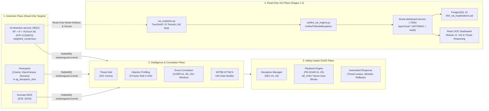

# Shadow Guard 2.0 — Complete System & XAI Architecture

## 1. End-to-End Architectural Planes (Detection vs. Explanation vs. Correlation vs. Response)

Shadow Guard 2.0 enforces a strict separation of concerns across four operational planes so that **Explanation** never alters **Detection** or **SOAR Response**:

## 2. Component Inventory & Data Flow
1. **React/JavaScript SOC Dashboard (`threat-dashboard-service/public/app.js`, `:7000`)**: 11 modules (Modules 1–10 core/tri-model/benchmark + **Module 11: Explainable AI & Threat Reasoning**), sending `X-SOC-Role` / `Authorization: Bearer <JWT>` headers.
2. **Node.js/Express API Gateway (`server.js`)**: Enforces JWT/API-Key/RBAC (`VIEWER`, `SOC_ANALYST`, `ADMIN`), role-based IP sanitization, timeouts (`8000 ms`), Prometheus `/metrics`, and `securityAuditLog`.
3. **PostgreSQL 15 (`001`–`004` migrations)**: 18 total tables (`threat_logs` + 17 v2 core tables + `xai_explanations` with JSONB columns, B-Tree/GIN indexes, and `uq_xai_flow_policy_signature`).
4. **Python ML & XAI Service (`ml-detection-service/main.py`)**: Serves `/detect`, `/detect/autoencoder`, `/detect/tri-model`, `/xai/health`, `/xai/explain`, and `/xai/explain/batch` over shared frozen artifacts (`random_forest_69_v2.pkl`, `isolation_forest_69_v2.pkl`, `autoencoder_model.pt`, `autoencoder_preprocessor.pkl`).
5. **Deception, Correlation & SOAR Microservices**: Suricata NIDS, Cowrie (zero-password retention), OpenCanary, Dionaea (`noexec` quarantine), Threat Intel, 5-factor Attacker Profiling, `CORR-01..06` correlation, MITRE ATT&CK kill chains, `DEC-01..04` adaptive deception, and `PB-SOAR-01..05` playbooks with timed leases and `AE_ONLY` non-auto-block guardrails.
