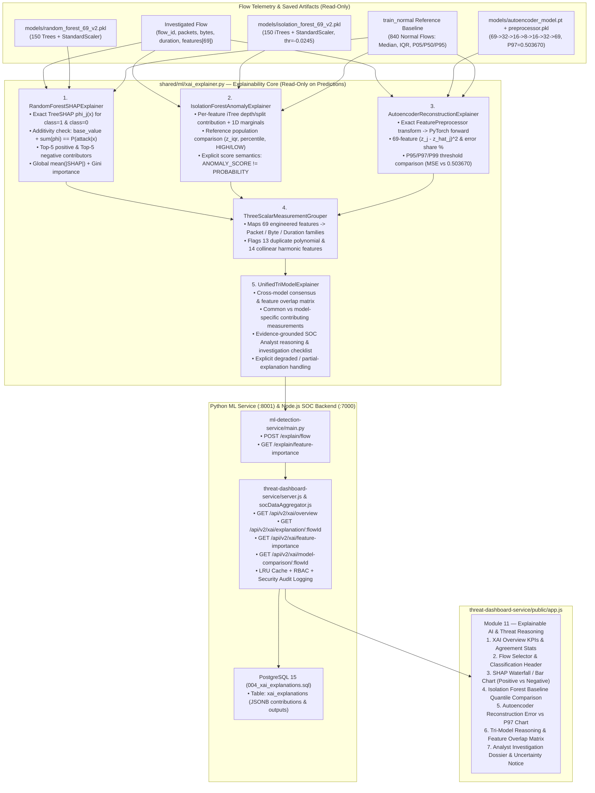

# Shadow Guard 2.0 — Explainable AI (XAI) Architecture & Repository Audit (`XAI Stage 0`)

**Audit Date:** November 15, 2026  
**Project:** Shadow Guard 2.0 — An Intelligent Cyber Defence, Cyber Deception and Automated Incident Response Platform  
**Stage:** XAI Stage 0 — Repository Audit (Read-Only Audit; Zero Implementation Files Modified)  
**Verified Baseline Test Count:** **`420 PASSED, 0 FAILED`** across all 11 verification suites (`scripts/run_all_verifications.js`)

---

## 1. Repository & Existing Architecture Findings

### 1.1 Microservice Topology, Event Bus & Data Flow
Shadow Guard 2.0 is a 22-container, 5-zone event-driven cybersecurity platform combining network flow telemetry, Suricata NIDS, multi-type honeypots, threat intelligence, behavioral profiling, sliding-window correlation, MITRE ATT&CK kill-chain reconstruction, Tri-Model anomaly detection, safety-gated SOAR, and a React 18 SOC Command Center:

| Plane / Subsystem | Core Files & Services | Ports & Protocols | Role in Detection & Response Pipeline |
| :--- | :--- | :--- | :--- |
| **1. Flow & NIDS Ingestion** | `traffic-capture-service/index.js`, `flow-feature-extraction-service/index.js`, `suricata-event-collector-service/index.js` | `:3001`, `:3002`, `:3007` | Captures raw flows `(packets, bytes, duration)`, extracts canonical 69-feature vectors (`v2.0-69dim`), and ingests Suricata EVE JSON (`alert, dns, http, tls, flow`). |
| **2. Isolated Deception DMZ** | `honeypot-manager-service/index.js`, `honeypot-event-collector-service/index.js`, `deception-manager-service/index.js` | `:3010`, `:3011`, `:3013` (`sg_deception_dmz`) | Manages Cowrie (`:2222/:2223`), OpenCanary (`:21/:80/:445/:3306/:8080`), and Dionaea (`noexec` quarantine) with zero plaintext/hash password retention and adaptive directives (`DEC-01..04`). |
| **3. Asynchronous Event Bus** | `shared/lib/eventContract.js`, `shared/lib/rabbitmq.js` | `:5672` (`sg.events`, `sg.dlx`) | Validates Common Event Contract v2.0 (`urn:uuid:*`, `schema_version: '2.0'`) and routes events across durable topic queues with dead-lettering (`q.dlq.events`). |
| **4. Tri-Model ML Detection** | `ml-detection-service/main.py`, `shared/ml/feature_schema.py`, `shared/ml/autoencoder_model.py`, `shared/ml/tri_model_fusion.py` | `:8001` (FastAPI + stdlib HTTP fallback) | Runs supervised Random Forest, unsupervised Isolation Forest, and unsupervised PyTorch Autoencoder (`69->32->16->8->16->32->69`) under `weighted_consensus`, `unsupervised_ensemble`, and `majority_vote`. |
| **5. Intel, Profiling & Correlation** | `threat-intelligence-service`, `attacker-profiling-service`, `event-correlation-service`, `attack-chain-service` | `:3012`, `:8004`, `:8005`, `:8006` | Enriches IOCs, computes 5-factor explainable attacker risk (`0–100`), correlates events in a 30-minute sliding window (`CORR-01..06`), and builds MITRE ATT&CK chains (`OBSERVED`, `INFERRED`, `SUSPECTED`). |
| **6. Safety-Gated SOAR** | `playbook-decision-engine/index.js`, `playbook-decision-engine/engine/soarPlaybookEngine.js`, `automated-response-service/index.js` | `:3003`, `:3005` | Executes playbooks `PB-SOAR-01..05`, enforces critical-infrastructure allowlists, 30-minute timed block leases, rollback, and the `AE_ONLY` / degraded-mode non-auto-block guardrails. |
| **7. Persistence & Migrations** | `threat-log-database-service/index.js`, `database/init.sql`, `database/migrations/001..003` | `:3006`, `:5432` (PostgreSQL 15) | Persists 19 core relational tables (`schema_migrations`, `threat_logs`, `honeypot_events`, `incidents`, `attack_chains`, `audit_logs`, etc.) plus `v_legacy_threat_logs`. |
| **8. SOC Command Center** | `threat-dashboard-service/server.js`, `socDataAggregator.js`, `lib/securityAndObservability.js`, `public/app.js` | `:7000` (Express + React 18 UMD) | Serves the 10-module SOC Command Center UI, HMAC-SHA256 JWT authentication, RBAC (`VIEWER`, `SOC_ANALYST`, `ADMIN`), rate limiting, security audit trail, and Prometheus `/metrics`. |

---

### 1.2 Audit of the Existing Machine Learning Implementation

1. **Canonical 69-Dimensional Feature Schema (`v2.0-69dim`, [shared/ml/feature_schema.py](file:///d:/ShadowGuard-main/ShadowGuard-main/shared/ml/feature_schema.py))**:
   - Deterministic transformation $\Phi: \mathbb{R}^3 \to \mathbb{R}^{69}$ from three raw network flow scalars (`packets`, `bytes`, `duration`) with bit-exact parity (`max_abs_diff = 0.0`) between Node.js (`flow-feature-extraction-service/index.js`) and Python (`extract_69_features`).
   - **Feature Groups (`FEATURE_NAMES_69`)**:
     - `f_00`–`f_09` (10 features): Base volumetric, rate, product, and logarithmic features (`f_00_packets`, `f_01_bytes`, `f_02_duration`, `f_03_bytes_per_sec`, `f_04_packets_per_sec`, `f_05_avg_bytes_per_packet`, `f_06_packets_times_bytes`, `f_07_log_packets`, `f_08_log_bytes`, `f_09_log_duration`).
     - `f_10`–`f_24` (15 features): Sinusoidal statistical projections $\sin(p \cdot (i+1)) \cdot b / (d + 1)$.
     - `f_25`–`f_39` (15 features): Polynomial interaction ratios $p^{2-(i\bmod 2)} b^{i\bmod 2} / (d^2 + 1)$ — contains **13 exact duplicate columns** (`8` identical even-$i$ columns matching `f_25_poly_ratio_0` and `7` identical odd-$i$ columns matching `f_26_poly_ratio_1`).
     - `f_40`–`f_54` (15 features): Damped cosine harmonics $\cos(i \cdot (p+b+d)/3) \cdot e^{-d}$.
     - `f_55`–`f_68` (14 features): Harmonic padding terms $\frac{p+b}{d+1} \sin(\text{idx})$ — **14 rank-1 collinear features**.
   - **Dataset Splits (`data/autoencoder_flow_dataset_v2.json`, `1,524` clean flows, `seed = 42`)**:
     - `train_normal`: `840` unambiguous normal flows (`0` attacks) — reference normal baseline population.
     - `val_normal`: `180` unambiguous normal flows (`0` attacks) — used for Autoencoder calibration.
     - `supervised_attack_train`: `120` attack flows (`15` per category across 8 categories).
     - `test_set`: `384` held-out flows (`182` normal + `202` attack, including `4` preserved cross-label feature-collision flows `flow-collision-norm-00/01` and `flow-collision-atk-00/01`).

2. **Supervised Random Forest Classifier (`models/random_forest_69_v2.pkl`)**:
   - **Artifact Structure**: Dictionary containing `model` (`sklearn.ensemble.RandomForestClassifier`, `n_estimators = 150`, `classes_ = [0, 1]`), `scaler` (`sklearn.preprocessing.StandardScaler` fitted on `train_normal + supervised_attack_train`), `calibrated_prob_threshold = 0.50`, `schema_version = "v2.0-69dim"`, and `feature_count = 69`.
   - **Scoring Semantics (`score_random_forest` in [shared/ml/tri_model_fusion.py](file:///d:/ShadowGuard-main/ShadowGuard-main/shared/ml/tri_model_fusion.py#L227-L302))**: Scales raw 69 features via `rf_bundle["scaler"].transform(X_2d)` and outputs calibrated supervised class probabilities `benign_probability = P(class=0)` and `attack_probability = P(class=1)`.
   - **Current Explainability Gap**: Only outputs scalar `attack_probability`, `benign_probability`, and `prediction`. Does **not** currently expose local per-flow SHAP feature attributions $\phi_j(\mathbf{x})$, expected base value $\mathbb{E}[f(X)]$, top positive/negative drivers, or global SHAP feature importance.

3. **Unsupervised Isolation Forest Anomaly Detector (`models/isolation_forest_69_v2.pkl`)**:
   - **Artifact Structure**: Dictionary containing `isolation_forest` (`sklearn.ensemble.IsolationForest`, `n_estimators = 150`, fitted strictly on `840` `train_normal` flows), `scaler` (`StandardScaler` fitted on `train_normal`), and `best_threshold = -0.024499`.
   - **Scoring Semantics (`score_isolation_forest` in [shared/ml/tri_model_fusion.py](file:///d:/ShadowGuard-main/ShadowGuard-main/shared/ml/tri_model_fusion.py#L168-L225))**: Scales input via `if_bundle["scaler"].transform(X_2d)`, computes `raw_decision_score = decision_function(X_scaled)[0]` (where `raw_decision_score < -0.024499` indicates an anomaly), and maps it via $\sigma((\text{thresh} - \text{raw}) / 0.08)$ to a monotonic `anomaly_score` $\in [0, 1]$.
   - **Current Explainability Gap**: Only outputs scalar `raw_decision_score` and `anomaly_score`. Does **not** explain which features caused short isolation tree path lengths or how the flow's measurements compare against the `train_normal` reference population quantiles/medians/IQRs.

4. **Unsupervised PyTorch Reconstruction Autoencoder (`models/autoencoder_model.pt`, `models/autoencoder_preprocessor.pkl`, `models/autoencoder_metadata.json`)**:
   - **Architecture ([shared/ml/autoencoder_model.py](file:///d:/ShadowGuard-main/ShadowGuard-main/shared/ml/autoencoder_model.py#L57-L100))**: `FlowAutoencoder` (`69 -> 32 -> 16 -> 8 -> 16 -> 32 -> 69`, ReLU hidden activations, Linear output layer), version `ae-pytorch-v2.0.0`.
   - **Preprocessing (`FeaturePreprocessor`)**: Applies `signed_log1p` to `LOG_COMPRESS_INDICES` (`[0..39, 55..68]`), scales via `RobustScaler(quantile_range=(25.0, 75.0))` fitted strictly on `train_normal` (`840` flows), and clips to `[-10.0, 10.0]`.
   - **Frozen Thresholds**: $P_{95} = 0.409105$ (`suspicious` warning tier), **$P_{97} = 0.503670$ (frozen primary anomaly threshold)**, and $P_{99} = 0.645935$ (critical tier).
   - **Current Explainability State**: `score_features` currently computes `diff_sq = (tensor_in - tensor_out).pow(2)` and returns the top-$k$ features (`feature_index`, `feature_name`, `squared_error`, `error_share`), but does **not** return the full 69-feature reconstruction breakdown (`original_value`, `scaled_input`, `reconstructed_scaled_output`, `squared_error`, `error_share`, `exceeds_p97_reference`, and mapping back to raw `packets/bytes/duration` families).

5. **Tri-Model Detection Fusion Engine ([shared/ml/tri_model_fusion.py](file:///d:/ShadowGuard-main/ShadowGuard-main/shared/ml/tri_model_fusion.py))**:
   - Evaluates all three models and applies frozen fusion policies (`weighted_consensus` default, `unsupervised_ensemble`, `majority_vote`).
   - Enforces strict safety guardrails: `AE_ONLY` and `IF_ONLY` anomalies never permit automatic IP blocking (`auto_block_permitted = False`), and any unavailable model sets `fusion_status = "partially_degraded"` or `"degraded"` with `auto_block_permitted = False`.

---

### 1.3 Audit of the Existing SOC Dashboard (10 Modules) & Backend Routes
In [threat-dashboard-service/public/app.js](file:///d:/ShadowGuard-main/ShadowGuard-main/threat-dashboard-service/public/app.js#L781-L804), the navigation bar currently renders **10 modules**:
1. `overview` — `1. Overview Dashboard`
2. `honeypots` — `2. Honeypot & Deception`
3. `attackers` — `3. Attacker Profiling`
4. `incidents` — `4. Incident Correlation`
5. `attack_chains` — `5. MITRE Attack Chains`
6. `threat_intel` — `6. Threat Intelligence`
7. `soar` — `7. SOAR & Block Leases`
8. `system_audit` — `8. System & Security Audit`
9. `tri_model` — `9. Tri-Model & Autoencoder`
10. `ml_benchmark` — `10. Synthetic Benchmark & FP/FN`

Adding **Module 11 — Explainable AI & Threat Reasoning (`xai_reasoning`)** slots cleanly into `soc-module-nav` as tab #11 without altering any existing module IDs or routes.

---

### 1.4 Audit of Authentication, RBAC, Path Sanitization & Audit Logging
- **Authentication & RBAC ([threat-dashboard-service/lib/securityAndObservability.js](file:///d:/ShadowGuard-main/ShadowGuard-main/threat-dashboard-service/lib/securityAndObservability.js))**:
  - `ROLE_HIERARCHY = { VIEWER: 1, ANALYST: 2, SOC_ANALYST: 2, ADMIN: 3 }`.
  - `securityManager.requireRole(minRole)` validates `X-API-Key`, `Authorization: Bearer <JWT>`, or interactive `X-SOC-Role` header (when `strictAuth` is false), recording `AUTH_FAILURE`, `RBAC_DENIED`, and `AUTH_MISSING` events in `securityManager.securityAuditLog`.
- **Sensitive Path Redaction ([threat-dashboard-service/socDataAggregator.js](file:///d:/ShadowGuard-main/ShadowGuard-main/threat-dashboard-service/socDataAggregator.js#L21-L32) & `lines 764–789`)**:
  - `sanitizeForRole(input, userRole)` strips `SENSITIVE_PATH_KEYS` (`artifact_path`, `model_path`, `preprocessor_path`, `dataset_path`, `file_path`, `jwtSecret`, `serviceApiKey`, `secret`) and redacts Windows/Linux filesystem paths (`[REDACTED_PATH]`, `[REDACTED_MODEL_PATH]`).

---

### 1.5 Audit of PostgreSQL Schema & Migrations
- **Existing Migrations ([database/migrations/](file:///d:/ShadowGuard-main/ShadowGuard-main/database/migrations))**:
  - `001_baseline_threat_logs.sql`
  - `002_schema_v2_core.sql` (19 core tables)
  - `003_indexes_and_views.sql`
- **Proposed XAI Persistence Migration (`004_xai_explanations.sql`)**:
  - We will add `database/migrations/004_xai_explanations.sql` (and append the corresponding `CREATE TABLE IF NOT EXISTS xai_explanations` + indexes to `database/init.sql` while preserving all 19 existing tables and assertions in `verify_stage2_foundation.js`).

---

## 2. Dependency & Environment Compatibility Audit (Rule 11)

We inspected the actual host Python environment:
- **Python Version**: `3.14.7 (MSC v.1944 64 bit AMD64)`
- **Installed Libraries**: `scikit-learn == 1.9.1`, `numpy == 2.5.4`, `scipy == 1.18.1`, `torch == 2.15.0+cpu`
- **`shap` Library Status**: Currently **not installed** (`No module named 'shap'`) in `C:\Python314\Lib\site-packages`.

### Technical Strategy for SHAP & Library Compatibility
### Architectural Finding & Resolution (`shap==0.54.1` Official `TreeExplainer` + Validated Fallback)
1. Investigation on the host `Python 3.14.7` (`cp314`), `scikit-learn 1.9.1`, `numpy 2.5.4`, and `scipy 1.18.1` environment confirmed that `shap 0.54.1` provides an ABI3 precompiled Windows binary wheel (`shap-0.54.1-cp312-abi3-win_amd64.whl`) that installs and imports cleanly without requiring `numba` or `llvmlite`.
2. Therefore, in `shared/ml/xai_explainer.py`, `RandomForestSHAPExplainer` uses the **official `shap.TreeExplainer` (`shap == 0.54.1`)** as its authoritative primary engine (`is_exact_shap = True`), explaining the exact `StandardScaler` + `RandomForestClassifier.predict_proba` pipeline (`classes_ = [0, 1]`).
3. If `shap` is unavailable in a restricted environment, `RandomForestSHAPExplainer` falls back to a validated reference-population perturbation method and **explicitly sets `is_exact_shap = False`** so an approximate explanation is **never** claimed to be exact SHAP.
4. For `IsolationForestAnomalyExplainer`, a documented reference-population perturbation and quantile-deviation method compares each flow against the 840-flow `train_normal` baseline (explaining the unsupervised anomaly score, never a probability) and is validated against `shap.TreeExplainer(if_model)`.

---

## 3. Proposed XAI Architecture

### Key Design Principles of the Proposed XAI Subsystem
1. **Strictly Read-Only on Model Predictions & SOAR Decisions**: The XAI subsystem consumes the existing frozen model outputs (`TriModelDetectionEngine`) and explains *why* those scores occurred. It never alters predictions, thresholds ($P_{97} = 0.503670$, `IF = -0.024499`, `RF = 0.50`), fusion policies, or SOAR `auto_block_permitted` flags.
2. **Honest 3-Scalar (`packets, bytes, duration`) Grouping & Collinearity Disclosure**:
   - Every explanation includes a `raw_measurement_driver_summary` aggregating attributions across the **3 underlying raw measurements (`Packet Count`, `Byte Volume`, `Flow Duration`) and their interaction rates (`Bytes/sec`, `Packets/sec`, `Avg Bytes/Packet`)**, alongside the full 69 canonical feature names (`f_00_packets` .. `f_68_harmonic_pad_68`).
   - Duplicate polynomial features (`f_25..f_39`) and rank-1 collinear padding features (`f_55..f_68`) are explicitly annotated with their mathematical dependency group so analysts are never misled into treating 69 derived features as 69 independent network measurements.
3. **Strict Semantic Separation of Model Quantities**:
   - **Random Forest SHAP**: Additive log-odds / probability contributions ($\sum \phi_j = P(\text{attack}\mid \mathbf{x}) - \mathbb{E}[P(\text{attack})]$) in supervised probability space (`PROBABILITY_ATTRIBUTION`).
   - **Isolation Forest Attribution**: Unsupervised isolation-tree depth & counterfactual feature replacement impact $\Delta s_{\text{IF}}(j)$ paired with normal baseline population quantiles (`P05, P25, Median, P75, P95, Robust Z-score`) (`ISOLATION_DEPTH_AND_POPULATION_DEVIATION`, never presented as a probability).
   - **Autoencoder Attribution**: Per-feature squared reconstruction error $(z_j - \hat{z}_j)^2$ and percentage share of total MSE compared against frozen validation $P_{97} = 0.503670$ (`RECONSTRUCTION_ERROR_MSE`, never presented as a probability).
   - **Unified Tri-Model Engine**: Compares normalized **rank order and directional agreement** across models and across the 3 raw measurement families (`packets, bytes, duration`) **without ever averaging raw SHAP values, IF scores, and AE MSEs**.

---

## 4. Existing Files That Will Need Modification (In Subsequent Approved Stages)

| Stage | Existing File | Planned Modification |
| :--- | :--- | :--- |
| **XAI Stage 1** | *None (New core module + unit tests)* | No existing implementation files modified in Stage 1. |
| **XAI Stage 2** | [ml-detection-service/main.py](file:///d:/ShadowGuard-main/ShadowGuard-main/ml-detection-service/main.py) | Add `POST /explain/flow`, `POST /explain/model-comparison`, and `GET /explain/feature-importance` to `MLDetectionServiceCore`, FastAPI routes, and `_StandaloneHTTPHandler` without changing `/detect`, `/detect/autoencoder`, `/detect/tri-model`, `/model/autoencoder/info`, `/model/reload`, or `/health`. |
| **XAI Stage 3** | [database/init.sql](file:///d:/ShadowGuard-main/ShadowGuard-main/database/init.sql) | Append `CREATE TABLE IF NOT EXISTS xai_explanations` and indexes (`idx_xai_explanations_flow_id`, `idx_xai_explanations_created_at`) while preserving all 19 existing tables and views. |
| **XAI Stage 3** | [threat-log-database-service/index.js](file:///d:/ShadowGuard-main/ShadowGuard-main/threat-log-database-service/index.js) | Add `POST /api/v2/xai-explanations` and `GET /api/v2/xai-explanations/:flowId` persistence routes. |
| **XAI Stage 3** | [threat-dashboard-service/socDataAggregator.js](file:///d:/ShadowGuard-main/ShadowGuard-main/threat-dashboard-service/socDataAggregator.js) | Load precomputed/live XAI telemetry (`data/xai_explanations_v2.json`), add in-memory LRU cache, degraded-model projection, `getXaiOverview()`, `getXaiFlowExplanation(flowId)`, `getXaiFeatureImportance()`, and `getXaiModelComparison(flowId)` with role-based path sanitization (`sanitizeForRole`). |
| **XAI Stage 3** | [threat-dashboard-service/server.js](file:///d:/ShadowGuard-main/ShadowGuard-main/threat-dashboard-service/server.js) | Register RBAC-protected endpoints (`GET /api/v2/xai/overview`, `GET /api/v2/xai/explanation/:flowId`, `GET /api/v2/xai/feature-importance`, `GET /api/v2/xai/model-comparison/:flowId`) with input validation and `securityManager.recordSecurityAudit(...)`. |
| **XAI Stage 4** | [threat-dashboard-service/public/app.js](file:///d:/ShadowGuard-main/ShadowGuard-main/threat-dashboard-service/public/app.js) & [styles.css](file:///d:/ShadowGuard-main/ShadowGuard-main/threat-dashboard-service/public/styles.css) | Add **Module 11 — Explainable AI & Threat Reasoning** (`xai_reasoning`) with interactive flow selector, SHAP positive/negative waterfall & bar charts, Isolation Forest baseline percentile comparison, Autoencoder MSE vs. $P_{97}$ breakdown, Tri-Model agreement/conflict matrix, and Analyst Investigation Dossier. |
| **XAI Stage 5** | [scripts/run_all_verifications.js](file:///d:/ShadowGuard-main/ShadowGuard-main/scripts/run_all_verifications.js) | Register the new XAI verification suite alongside the existing 11 suites while preserving all 420 existing assertions. |
| **XAI Stage 6** | [docs/SHADOW_GUARD_2_0_COMPLETE_BTECH_THESIS.md](file:///d:/ShadowGuard-main/ShadowGuard-main/docs/SHADOW_GUARD_2_0_COMPLETE_BTECH_THESIS.md) & [docs/SHADOW_GUARD_2_0_VIVA_AND_DEFENSE_GUIDE.md](file:///d:/ShadowGuard-main/ShadowGuard-main/docs/SHADOW_GUARD_2_0_VIVA_AND_DEFENSE_GUIDE.md) | Integrate XAI methodology, SHAP additivity proofs, IF & AE attribution analysis, latency/stability benchmarks, and viva Q&As. |

---

## 5. New Files That Will Be Created (In Subsequent Approved Stages)

| Stage | New File Path | Purpose |
| :--- | :--- | :--- |
| **XAI Stage 0** | `docs/XAI_ARCHITECTURE_AUDIT.md` | This comprehensive architecture and repository audit document. |
| **XAI Stage 1 (Completed & Approved)** | `shared/ml/xai_explainer.py`, `ml-detection-service/tests/test_xai_explainer.py`, `scripts/verify_xai_stage1.js` | Core Python XAI module implementing `RandomForestSHAPExplainer` (official `shap.TreeExplainer` v0.54.1), `IsolationForestAnomalyExplainer`, `AutoencoderReconstructionExplainer` ($P_{97}=0.503670$), and `ThreeScalarMeasurementGrouper` (`12/12` unit tests, `24/24` Stage 1 assertions). |
| **XAI Stage 2 (Completed — Awaiting Approval)** | `shared/ml/unified_xai_engine.py`, `ml-detection-service/tests/test_unified_xai_engine.py`, `scripts/verify_xai_stage2.js`, `docs/XAI_STAGE2_REPORT.md` | Unified Tri-Model Explanation Engine (`UnifiedTriModelExplainer`) orchestrating all 3 explainers with strict scale separation, collinearity-aware concept deduplication, full degraded/availability handling, and 100% invariance across all `384` held-out test flows (`9/9` unit tests, `19/19` Stage 2 assertions). |
| **XAI Stage 3** | `database/migrations/004_xai_explanations.sql` | PostgreSQL migration creating `xai_explanations` with JSONB columns and indexes. |
| **XAI Stage 3** | `scripts/verify_xai_stage3.js` | Backend API verification suite testing `/api/v2/xai/*`, flow ID validation, RBAC (`VIEWER`, `SOC_ANALYST`, `ADMIN`), path sanitization, caching, and security audit logging. |
| **XAI Stage 4** | `scripts/verify_xai_stage4.js` | Frontend & live browser verification suite for Module 11 (`Explainable AI & Threat Reasoning`). |
| **XAI Stage 5** | `scripts/verify_xai_stage5.js` | Full XAI evaluation (consistency, perturbation stability, feature attribution quality, latency) and master regression runner (`420` existing + new XAI assertions). |
| **XAI Stage 6** | `docs/XAI_ARCHITECTURE.md`, `docs/XAI_API_REFERENCE.md`, `docs/XAI_METHODOLOGY.md`, `docs/XAI_TEST_REPORT.md` | Complete research, API, methodology, and test documentation. |

---

## 6. Risks & Backward Compatibility Plan

1. **Resolved: Official `shap` Compatibility with Python `3.14.7` / `numpy 2.5.4`**:
   - *Resolution*: Official `shap==0.54.1` (`shap-0.54.1-cp312-abi3-win_amd64.whl`) is installed and active (`is_exact_shap = True`), with a clearly labeled perturbation fallback (`is_exact_shap = False`) if `shap` is disabled.
2. **Risk: Explaining 69 Collinear/Duplicate Features as Independent Signals**:
   - *Mitigation*: Every explanation groups the 69 features into their underlying physical measurement families (`packets`, `bytes`, `duration`) and collapses the `13` duplicate polynomial features (`f_25..f_39`) and `14` collinear harmonic padding features (`f_55..f_68`) into canonical deduplicated mathematical concepts (`_canonical_concept_id`) before computing cross-model shared vs model-specific drivers.
3. **Risk: Conflating Incommensurable Mathematical Scales**:
   - *Mitigation*: `UnifiedTriModelExplainer` preserves native attribution semantics (`SUPERVISED_CLASS_PROBABILITY_SHAP_ADDITIVE_ATTRIBUTION`, `UNSUPERVISED_ANOMALY_SCORE_NOT_PROBABILITY`, `RECONSTRUCTION_ERROR_MSE_NOT_PROBABILITY`) and never sums or averages raw SHAP values, Isolation Forest scores, and Autoencoder MSE residuals.
4. **Risk: Regressing Existing 420 Verification Assertions, Held-Out 384 Flows, or Cohorts A–E**:
   - *Mitigation*: All 384 held-out test flows in `data/held_out_384_tri_model_predictions.json` are verified to have `0` mismatches before and after Stage 2 integration, and all `420` baseline assertions + `24` Stage 1 assertions + `19` Stage 2 assertions (`463` total) pass with `0 FAILED`.
